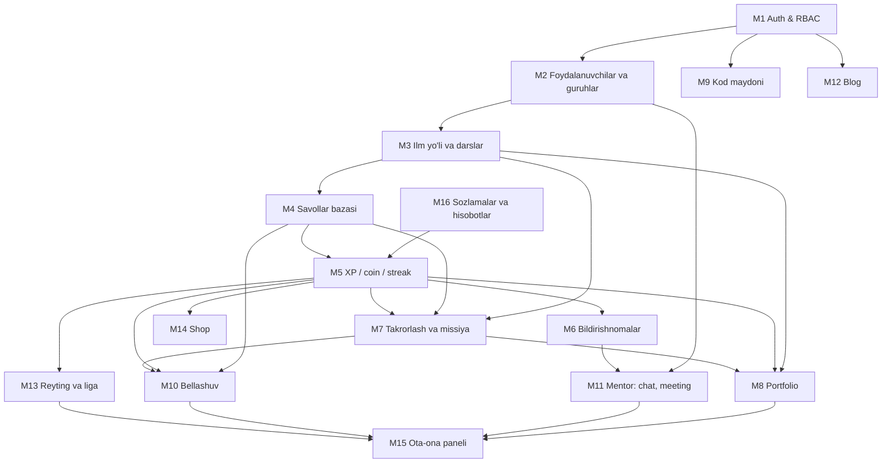
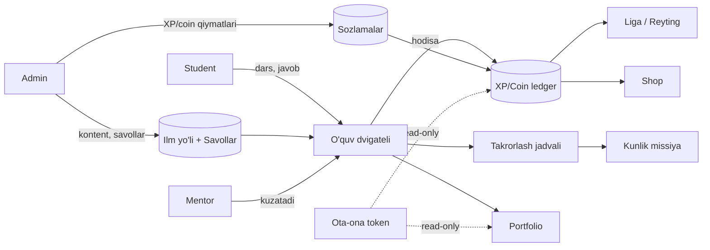

# 00. Umumiy ko'rinish

> **Qisqa mazmun:** Loyiha maqsadi, foydalanuvchilar, asosiy modullar va ular o'rtasidagi bog'liqlik. Bu fayl boshqa barcha hujjatlar uchun asos.

---

## 1. Loyiha maqsadi

IT yo'nalishidagi to'liq onlayn ta'lim platformasi (LMS). Asosiy g'oyalar:

| G'oya | Izoh |
|---|---|
| **To'liq onlayn** | Barcha o'quv jarayoni platforma ichida. |
| **Matnli darslar** | Dars — matn (Markdown), ixtiyoriy video havola bilan. |
| **"Kurs" emas, "ilm yo'li"** | Uzun zanjir ko'rinishidagi yo'l: mavzular ketma-ket, orada mukofot sandiqlari. |
| **Gamifikatsiya** | XP, coin, streak, haftalik liga, 1v1 bellashuv, yutuqlar, shop. |
| **Spaced repetition** | Tizim har bir mavzu uchun keyingi takrorlash vaqtini hisoblaydi. |
| **Mentorlik** | Guruh mentori: chat, jonli meeting, davomat, materiallar, portfolio baholash. |
| **Ota-ona nazorati** | Akkauntsiz, token orqali faqat o'qish rejimida kirish. |
| **AI mentor** | Kelajakda (hozirgi scope'dan tashqarida). |
| **O'z dizayni** | Tayyor shablon emas, maxsus UI. |

## 2. Foydalanuvchilar

| Rol | Kirish usuli | Asosiy vazifasi |
|---|---|---|
| Super admin | Telefon + parol | Platforma egasi, adminlar va tizim sozlamalari |
| Admin | Telefon + parol | Foydalanuvchilar, guruhlar, kontent, shop, blog moderatsiyasi, hisobotlar |
| Mentor | Telefon + parol | O'z guruhlari: kuzatuv, chat, meeting, davomat, materiallar, portfolio baholash, ota-ona tokeni |
| Student | Student ID (`ST-10245`) + parol | O'qish va barcha student sahifalari |
| Ota-ona | Token (akkauntsiz) | Farzand ma'lumotlarini faqat ko'rish |

Email platformada umuman ishlatilmaydi.

## 3. Asosiy modullar

| # | Modul | Qisqacha | Hujjat |
|---|---|---|---|
| M1 | **Auth & RBAC** | 3 xil kirish, JWT, rollar, guard'lar | 01, 02 |
| M2 | **Foydalanuvchilar va guruhlar** | Admin/mentor/student CRUD, guruh, mentor biriktirish | 01, 03 |
| M3 | **Ilm yo'li va darslar** | Yo'l → bo'lim → mavzu → dars, xarita, sandiqlar, progress | 05 |
| M4 | **Savollar bazasi** | Yagona savollar banki (dars, takrorlash, quiz, bellashuv) | 05 |
| M5 | **Gamifikatsiya yadrosi** | XP/coin ledger, streak, yutuqlar, sozlamalar | 04 |
| M6 | **Bildirishnomalar** | In-app, real-time | 03, 04 |
| M7 | **Takrorlash va kunlik missiya** | Spaced repetition, missiyalar, haftalik quiz | 04, 05 |
| M8 | **Portfolio** | Statistika, grafiklar, ko'nikmalar, loyihalar, sertifikatlar, ulashish | 09 |
| M9 | **Kod maydoni** | HTML/CSS/JS/Python editor + natija/terminal | 07 |
| M10 | **Bellashuv** | 1v1 real-time, do'st yoki bot | 06 |
| M11 | **Mentor sahifasi** | Chat, meeting, davomat, materiallar | 08 |
| M12 | **Blog** | X'ga o'xshash postlar, like, komment, moderatsiya | 09 |
| M13 | **Reyting va ligalar** | Haftalik XP ligasi, ko'tarilish/tushish | 04 |
| M14 | **Shop** | Coinga mahsulot, buyurtmalar | 09 |
| M15 | **Ota-ona paneli** | Token bilan read-only ko'rinish | 10 |
| M16 | **Admin: hisobotlar va sozlamalar** | Tizim sozlamalari, hisobotlar, audit | 03, 04 |
| M17 | **AI mentor** | Keyinroq | 14 |

## 4. Modullar o'rtasidagi bog'liqlik

**Asosiy xulosalar:**
- **M5 (XP/coin ledger)** — markaziy modul: dars, takrorlash, quiz, bellashuv, davomat, portfolio, sandiqlar, shop hammasi u orqali ishlaydi. Unga sozlamalar (M16) kerak, chunki raqamlar kodga yozilmaydi.
- **M4 (savollar bazasi)** — bitta bank, uni 4 ta iste'molchi ishlatadi: dars, takrorlash, quiz, bellashuv.
- **M15 (ota-ona paneli)** — eng oxirgi modul, chunki u boshqa modullar ma'lumotlarining read-only "yig'indisi".

## 5. Yuqori darajadagi ma'lumot oqimi

## 6. Scope

**Hozirgi scope ichida:** M1–M16.
**Scope'dan tashqarida:** AI mentor (M17), email, to'lov/obuna (tavsifda yo'q), mobil ilova (tavsifda yo'q; web responsive bo'ladi).

## 7. Asosiy taxminlar

- **Taxmin:** Platformada bir nechta ilm yo'li bo'lishi mumkin (masalan Frontend, Backend). Student guruhi orqali bitta yo'lga biriktiriladi. → S-01
- **Taxmin:** Student bir vaqtda faqat bitta faol guruhda bo'ladi. → S-02
- **Taxmin:** Guruhda bitta mentor bo'ladi, mentorda esa bir nechta guruh bo'lishi mumkin. → S-03
- **Taxmin:** Interfeys tili o'zbek (lotin), lekin i18n'ga tayyor qilib quriladi. → S-04
- **Taxmin:** Platformada to'lov/obuna yo'q, studentni admin yaratadi. → S-06

---

## Ochiq savollar (shu modul)

- **S-01** Bitta umumiy ilm yo'li bormi yoki bir nechta yo'nalish bo'yicha yo'llarmi?
- **S-02** Student bir vaqtda bir nechta guruhda bo'la oladimi?
- **S-03** Guruhga bir nechta mentor (masalan, asosiy + yordamchi) biriktirilishi mumkinmi?
- **S-04** Interfeys tillari: faqat o'zbekmi, rus/ingliz ham kerakmi?
- **S-05** Kutilayotgan masshtab: nechta student, bir vaqtda nechta onlayn foydalanuvchi?
- **S-06** Platformada to'lov/obuna moduli kerakmi?
