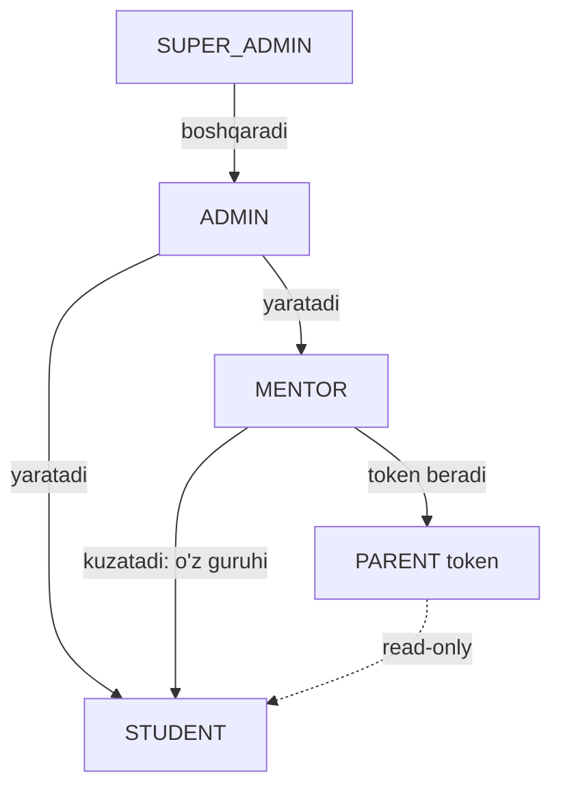
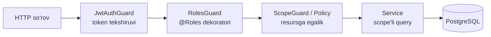

# 01. Rollar va ruxsatlar

> **Qisqa mazmun:** 5 ta rol, har bir modul bo'yicha ruxsatlar matritsasi (ko'rish / yaratish / tahrirlash / o'chirish) va mentorni faqat o'z guruhlari bilan cheklash mexanizmi (scope). Backend'da RBAC qanday quriladi.

---

## 1. Rollar

| Rol | Kod | Akkaunt | Tavsif |
|---|---|---|---|
| Super admin | `SUPER_ADMIN` | Ha | Hamma narsaga to'liq kirish. Adminlarni boshqaradi, tizim sozlamalari. |
| Admin | `ADMIN` | Ha | Student/mentor, guruhlar, kontent, shop, blog moderatsiyasi, hisobotlar. |
| Mentor | `MENTOR` | Ha | Faqat o'z guruhlari. Kontentni o'zgartira olmaydi, foydalanuvchi yarata olmaydi. |
| Student | `STUDENT` | Ha | O'qish va student sahifalari. Faqat o'z ma'lumotlari. |
| Ota-ona | `PARENT` (virtual) | **Yo'q** | Token orqali, faqat o'qish. Faqat token bog'langan farzand(lar). |

Rollar ierarxiyasi (ruxsatlar meros qilinmaydi, har biri aniq yoziladi):



- **Taxmin:** Super admin admin bajara oladigan barcha operatsion amallarni ham bajara oladi ("hamma narsaga to'liq kirish"). → S-07
- **Taxmin:** Admin boshqa adminlarni yarata/tahrirlay olmaydi, buni faqat super admin qiladi. → S-11

## 2. Ruxsatlar matritsasi

Belgilar: **K** = ko'rish, **Y** = yaratish, **T** = tahrirlash, **O'** = o'chirish (yoki deaktivatsiya), **—** = ruxsat yo'q.
Scope: *o'zi* = faqat o'z yozuvi, *guruh* = faqat o'z guruhlaridagi studentlar, *farzand* = token bog'langan student.

### 2.1 Foydalanuvchilar va guruhlar

| Resurs | Super admin | Admin | Mentor | Student | Ota-ona |
|---|---|---|---|---|---|
| Adminlar | K Y T O' | — | — | — | — |
| Mentorlar | K Y T O' | K Y T O' | K (o'zi) T (o'z profili) | K (o'z mentori, profil) | K (farzand mentori: ism) |
| Studentlar | K Y T O' | K Y T O' | K (guruh) | K T (o'zi, cheklangan maydonlar) | K (farzand) |
| Student parolini tiklash | ✔ | ✔ | ✔ (guruh) | — | — |
| Guruhlar | K Y T O' | K Y T O' | K (o'z guruhlari) | K (o'z guruhi) | — |
| Mentorni guruhga biriktirish | ✔ | ✔ | — | — | — |
| Studentni guruhga qo'shish | ✔ | ✔ | — | — | — |
| Ota-ona tokeni | K Y O' | K Y O' | K Y O' (guruh) | — | — |

- **Taxmin:** O'chirish = soft delete / deaktivatsiya (`status = INACTIVE`, `deleted_at`). Tranzaksiyalar va tarix saqlanadi. → S-08
- **Taxmin:** Admin ham ota-ona tokenini yarata oladi (admin "hamma studentlarni boshqaradi"). Tavsifda faqat mentor tilga olingan. → S-07

### 2.2 Kontent: ilm yo'li, darslar, savollar

| Resurs | Super admin | Admin | Mentor | Student | Ota-ona |
|---|---|---|---|---|---|
| Ilm yo'li, bo'lim, mavzu | K Y T O' | K Y T O' | K | K (ochilganlari) | — |
| Darslar | K Y T O' | K Y T O' | K | K (ochilganlari) | — |
| Savollar | K Y T O' | K Y T O' | K | Javob beradi (to'g'ri javobsiz) | — |
| Sandiqlar | K Y T O' | K Y T O' | K | K, ochish | — |
| Progress | K | K | K (guruh) | K (o'zi) | K (farzand) |

### 2.3 Gamifikatsiya

| Resurs | Super admin | Admin | Mentor | Student | Ota-ona |
|---|---|---|---|---|---|
| XP/coin qiymatlari (sozlamalar) | K T | K T | — | — | — |
| XP/coin tranzaksiyalari | K + qo'lda tuzatish | K + qo'lda tuzatish | K (guruh) | K (o'zi) | K (farzand) |
| Streak | K | K | K (guruh) | K (o'zi) | K (farzand) |
| Liga, reyting | K + sozlash | K + sozlash | K | K | K (farzand o'rni) |
| Yutuqlar (ta'rifi) | K Y T O' | K Y T O' | K | K | K (farzandniki) |
| Tizim sozlamalari (umumiy) | K T | — | — | — | — |

- **Taxmin:** Admin qo'lda XP/coin qo'shishi/ayirishi mumkin, faqat sabab yozilgan holda (`ADJUSTMENT` tranzaksiyasi). Mentor bunday qila olmaydi. → S-29

### 2.4 O'quv faoliyati

| Resurs | Super admin | Admin | Mentor | Student | Ota-ona |
|---|---|---|---|---|---|
| Takrorlash, missiya, quiz | K (hisobot) | K (hisobot) | K (guruh natijalari) | Bajaradi | K (natijalar) |
| Bellashuv | K | K | K (guruh natijalari) | Y (o'ynaydi) | K (farzand natijalari) |
| Kod maydoni (snippet) | — | — | — | K Y T O' (o'zi) | — |

### 2.5 Mentorlik

| Resurs | Super admin | Admin | Mentor | Student | Ota-ona |
|---|---|---|---|---|---|
| Chat | Taxmin: K (audit) | — | K Y (guruh studentlari bilan) | K Y (o'z mentori bilan) | — |
| Meetinglar | K | K | K Y T O' (o'z guruhlari) | K, qo'shilish | — |
| Davomat | K | K | K Y T (o'z guruhlari) | K (o'zi) | K (farzand) |
| Materiallar | K | K | K Y T O' (o'z guruhlari) | K (o'z guruhi) | — |
| Portfolio loyihasini baholash | K | K | Y T (guruh) | Topshiradi, K | K (farzand) |

- **Taxmin:** Chatni faqat super admin audit maqsadida ko'ra oladi, admin ko'ra olmaydi. → S-48

### 2.6 Blog, portfolio, shop, bildirishnomalar

| Resurs | Super admin | Admin | Mentor | Student | Ota-ona |
|---|---|---|---|---|---|
| Blog post | K, yashirish/o'chirish | K, yashirish/o'chirish | K | K Y T O' (o'ziniki), like, komment | — |
| Blog komment | K, yashirish | K, yashirish | K | K Y O' (o'ziniki) | — |
| Shikoyatlar (report) | K, hal qilish | K, hal qilish | — | Y | — |
| Portfolio | K | K | K (guruh) | K T (o'zi), ulashish | K (farzand) |
| Sertifikatlar | K Y O' | K Y O' | K (guruh) | K, yuklab olish | K (farzand) |
| Shop mahsulotlari | K Y T O' | K Y T O' | — | K | — |
| Buyurtmalar | K T (status) | K T (status) | — | Y, K (o'zi) | — |
| Bildirishnomalar | o'zi | o'zi | o'zi | o'zi | — |
| Hisobotlar | K | K | Taxmin: K (guruh) | — | — |
| Audit log | K | Taxmin: K (o'z amallari) | — | — | — |

- **Taxmin:** Blogda faqat studentlar post yozadi. Mentor va admin o'qiydi, admin moderatsiya qiladi. → S-09

## 3. Mentorni o'z guruhlari bilan cheklash (scope)

### 3.1 Qoida
Mentor student `X` haqidagi ma'lumotga faqat quyidagi shart bajarilganda kira oladi:

```
EXISTS group_members gm JOIN groups g ON g.id = gm.group_id
WHERE gm.student_id = X
  AND gm.left_at IS NULL           -- faol a'zolik
  AND g.mentor_id = currentMentor
  AND g.status = 'ACTIVE'
```

- **Taxmin:** Student guruhdan chiqqach (yoki boshqa guruhga o'tgach), eski mentor uning ma'lumotlarini ko'ra olmaydi. Tarixiy davomat yozuvlari esa mentorning o'z meetinglari doirasida ko'rinib qoladi. → S-10

### 3.2 Backend'da qatlamlar (NestJS)



1. **`JwtAuthGuard`** — access tokenni tekshiradi, `req.user = { id, role, ... }`.
2. **`RolesGuard`** — endpoint ustidagi `@Roles('ADMIN','SUPER_ADMIN')` bilan solishtiradi.
3. **`ScopeGuard` (policy)** — resursga xos tekshiruv:
   - `@StudentScope('studentId')` — URL'dagi `studentId` uchun: admin/super admin → o'tadi; mentor → yuqoridagi SQL sharti; student → `studentId === user.id`; parent → `studentId ∈ token.studentIds`.
   - `@GroupScope('groupId')` — mentor uchun `group.mentor_id === user.id`.
4. **Service qatlami** — ro'yxat qaytaradigan endpointlarda (masalan `GET /mentor/students`) filtr query'ning o'zida qo'llanadi, ya'ni avval hammasini olib, keyin filtrlanmaydi. Bu ma'lumot sizib chiqishining oldini oladi.
5. **Kesh:** `mentor:{id}:studentIds` Redis'da qisqa TTL bilan (masalan 60 s) saqlanadi va guruh a'zoligi o'zgarganda invalidatsiya qilinadi.

### 3.3 Ota-ona scope'i
- Parent JWT'da `role = PARENT`, `sub = parentTokenId`, `studentIds = [...]` bo'ladi (batafsil: 02-auth).
- Faqat `GET` endpointlarga ruxsat. Global `ParentReadOnlyGuard` boshqa har qanday method'ni `403` bilan rad etadi.
- Har bir so'rovda token bekor qilinmaganligi tekshiriladi (Redis'da kesh, bekor qilinganda o'chiriladi).

### 3.4 Ma'lumotni yashirish (field-level)
- Student → savol javoblari: `is_correct` va to'g'ri variant javob yuborilgunga qadar qaytarilmaydi.
- Mentor/ota-ona → student telefon raqami yoki parol hash'i hech qachon qaytarilmaydi (studentda telefon umuman bo'lmasligi mumkin).
- Public portfolio → faqat ism, statistika, loyihalar. ID va shaxsiy ma'lumotlar ko'rsatilmaydi.

## 4. Audit
Muhim amallar `audit_logs` jadvaliga yoziladi: foydalanuvchi yaratish/o'chirish, parol tiklash, token yaratish/bekor qilish, XP/coin qo'lda tuzatish, sozlamalarni o'zgartirish, blog moderatsiyasi, buyurtma statusi.

---

## Ochiq savollar (shu modul)

- **S-07** Super admin admin ishlarini ham bajaradimi? Admin ota-ona tokenini yarata oladimi?
- **S-08** Foydalanuvchini o'chirish soft delete bo'ladimi yoki butunlay o'chiriladimi?
- **S-09** Mentor/admin blogda post yoki komment yoza oladimi?
- **S-10** Guruhdan chiqqan studentning tarixini eski mentor ko'radimi?
- **S-11** Admin boshqa adminlarni boshqara oladimi?
- **S-48** Mentor–student chatini kim ko'ra oladi (audit/moderatsiya)?
