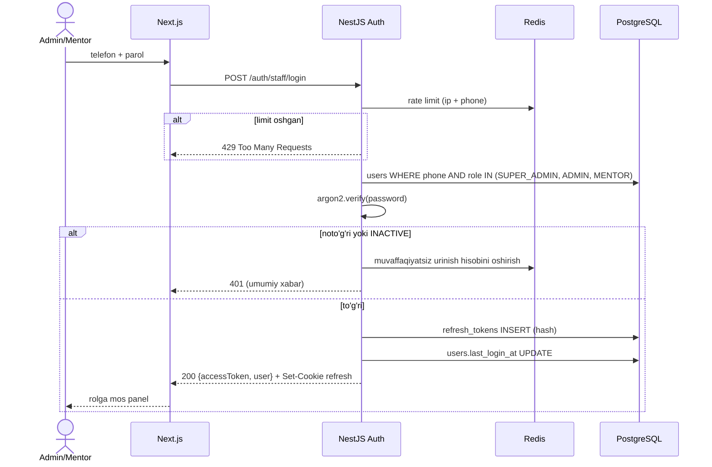
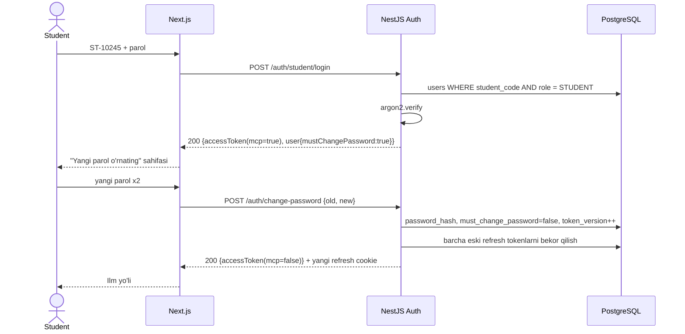
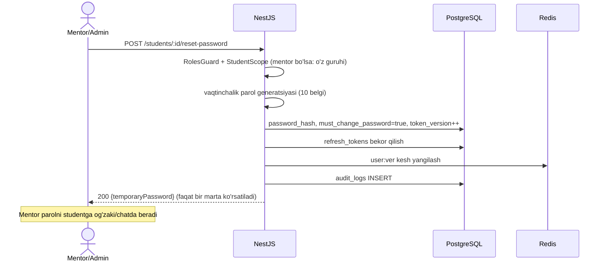
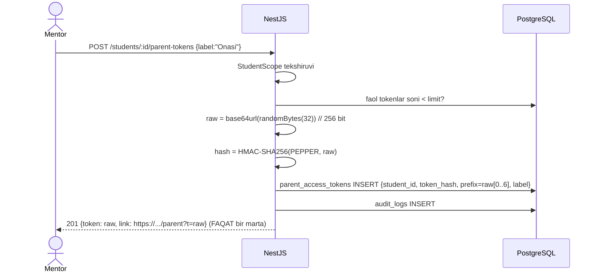
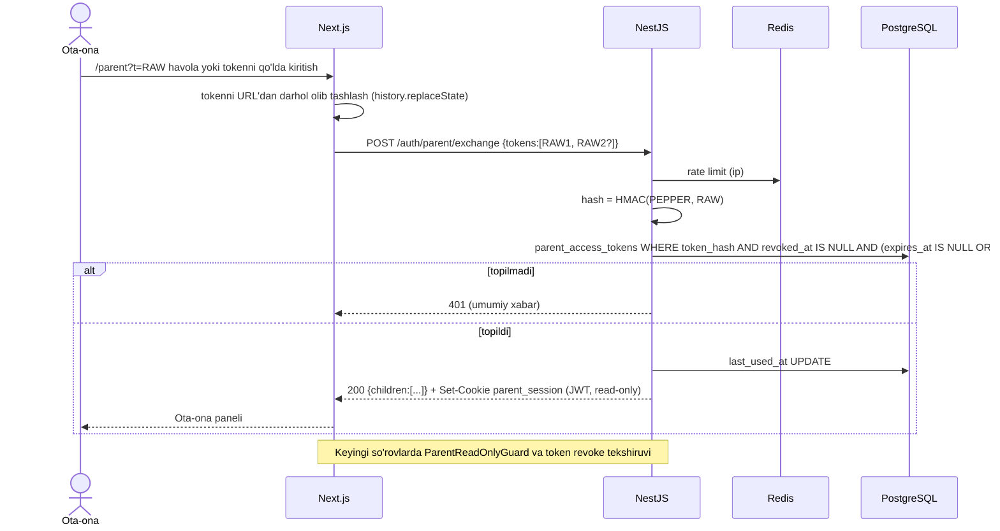

# 02. Autentifikatsiya (auth)

> **Qisqa mazmun:** 3 xil kirish usuli (telefon + parol, student ID + parol, ota-ona tokeni), har biri uchun sequence diagramma, JWT access/refresh strategiyasi, parolni tiklash va birinchi kirishda almashtirish, ota-ona tokeni xavfsizligi.

---

## 1. Umumiy

| Kim | Login maydoni | Maxfiy qism | Endpoint |
|---|---|---|---|
| Super admin, admin, mentor | `phone` (E.164, `+998XXXXXXXXX`) | `password` | `POST /auth/staff/login` |
| Student | `studentCode` (`ST-10245`) | `password` | `POST /auth/student/login` |
| Ota-ona | — | `token` (uzun, tasodifiy) | `POST /auth/parent/exchange` |

- Email umuman yo'q. Auth jarayonida SMS ham yo'q (tavsifda yo'q).
- Parollar **Argon2id** bilan hash qilinadi (bcrypt ham mumkin, lekin Argon2id tavsiya etiladi).
- Telefon raqam saqlashdan oldin normalizatsiya qilinadi va `UNIQUE` bo'ladi.
- Studentlarda telefon maydoni majburiy emas.

## 2. Student ID generatsiyasi
- Format: `ST-` + raqam. PostgreSQL `SEQUENCE` (`student_code_seq`) orqali beriladi, bu poyga holatisiz (race-free).
- **Taxmin:** Raqam 10001 dan boshlanadi va ketma-ket oshadi. Boshlang'ich parolni admin kiritadi yoki tizim generatsiya qiladi. → S-18
- Student yaratilganda `must_change_password = true` bo'ladi.

## 3. JWT strategiyasi

| Token | Saqlash | Muddat (Taxmin → S-12) | Tarkibi |
|---|---|---|---|
| Access | Frontend xotirasi (memory) | 15 daqiqa | `sub`, `role`, `mcp` (must change password), `ver` |
| Refresh | `HttpOnly; Secure; SameSite=Strict` cookie | Student: 30 kun, staff: 7 kun | Opaque tasodifiy satr, bazada hash |
| Parent session | `HttpOnly` cookie | 12 soat (sliding) | `sub=parentTokenId`, `role=PARENT`, `studentIds` |

- **Refresh rotation:** har bir `/auth/refresh` chaqiruvida yangi refresh token beriladi, eskisi `revoked` bo'ladi. Eski token qayta ishlatilsa (reuse detection), shu "oila"dagi barcha sessiyalar bekor qilinadi.
- **`token_version`:** `users.token_version` maydoni. Parol tiklanganda yoki foydalanuvchi deaktivatsiya qilinganda u oshiriladi va barcha eski access tokenlar yaroqsiz bo'ladi (`ver` mos kelmaydi). Uni har so'rovda tekshirish uchun Redis keshi ishlatiladi.
- `must_change_password = true` bo'lsa, access token faqat `POST /auth/change-password` va `GET /auth/me` uchun ishlaydi (`PasswordChangeRequiredGuard`).
- Socket.IO ulanishi ham access token bilan autentifikatsiya qilinadi (`auth.token` handshake).

## 4. Sequence diagrammalar

### 4.1 Staff: telefon + parol

### 4.2 Student: ID + parol (birinchi kirish bilan)

### 4.3 Parolni tiklash (admin yoki mentor tomonidan)

- **Taxmin:** Admin va mentor parolini kim tiklaydi: mentorni admin yoki super admin, adminni faqat super admin tiklaydi. "Parolni unutdim" sahifasi o'z-o'ziga xizmat qilmaydi, faqat "administratoringizga murojaat qiling" degan xabarni ko'rsatadi. → S-14
- **Taxmin:** Super admin birinchi marta seed/CLI buyrug'i bilan yaratiladi (`pnpm cli create-super-admin`). → S-13

### 4.4 Ota-ona tokeni: yaratish

### 4.5 Ota-ona: kirish (token exchange)

## 5. Ota-ona tokeni xavfsizligi

| Talab | Yechim |
|---|---|
| Uzun va tasodifiy | `crypto.randomBytes(32)` → base64url (43 belgi, 256 bit entropiya) |
| Bazada hash | `HMAC-SHA256(server_pepper, token)`. Entropiya yuqori bo'lgani uchun sekin hash shart emas, HMAC tezkor qidiruv uchun indekslanadi. Pepper env/secret manager'da saqlanadi. |
| Bekor qilish | `revoked_at`, `revoked_by`. Redis'dagi `parent_token:{id}:valid` keshi o'chiriladi va keyingi so'rovda sessiya tugaydi. |
| Qayta yaratish | Yangi token yaratiladi va eskisi bekor qilinadi ("regenerate" = revoke + create, bitta tranzaksiyada). |
| Read-only | JWT `role=PARENT`. `ParentReadOnlyGuard` faqat `GET` (va `/auth/parent/*`) ga ruxsat beradi. Parent controller'lari alohida modulda turadi va mutatsiya qiluvchi endpointlar u yerga umuman qo'shilmaydi. |
| Rate limit | `/auth/parent/exchange`: IP bo'yicha 10 urinish/15 daqiqa. 20 ta muvaffaqiyatsiz urinishdan keyin IP 1 soatga bloklanadi. |
| Token oshkor bo'lishi | Token URL'dan darhol tozalanadi, `Referrer-Policy: no-referrer`, token log'larga yozilmaydi (log'larda faqat `prefix`). |
| Kuzatuv | `last_used_at`, `use_count`. Mentor token ro'yxatida "oxirgi foydalanilgan vaqt"ni ko'radi. |

### 5.1 Bir nechta farzand
Tavsifda: "Bir ota-onaning bir nechta farzandi bo'lishi mumkin" va "token student profilidan beriladi". Bu ikki talab birga quyidagicha amalga oshiriladi:

**Qaror (S-15, egasi tasdiqlagan):** token **har bir farzand uchun alohida** yaratiladi (student profilidan) va ota-ona panelida birlashtiriladi. Kirishning ikki yo'li bor:
1. **Mentor yuborgan havola** (`/parent?t=...`): havola ochilganda token brauzerda saqlanadi va keyingi tashriflarda qayta kiritish talab qilinmaydi.
2. **Saytda kod kiritish**: ota-ona panelidagi "Farzand qo'shish" orqali boshqa farzandning kodi kiritiladi va u mavjud sessiyaga qo'shiladi.

Tokenni brauzerda saqlash usuli:
- Xom tokenlar `HttpOnly; Secure; SameSite=Strict` cookie'da (`parent_tokens`, `Path=/api/v1/auth/parent`) server kaliti bilan shifrlangan holda saqlanadi. `localStorage` ishlatilmaydi, chunki XSS bo'lsa token o'g'irlanishi mumkin.
- Qisqa umrli `parent_session` tugaganda frontend `POST /auth/parent/exchange` ni body'siz chaqiradi. Server cookie'dagi tokenlarni qayta tekshiradi va yangi session beradi. Bekor qilingan tokenlar cookie'dan olib tashlanadi.
- **Taxmin:** `parent_tokens` cookie muddati 180 kun (sozlama). → S-16
- "Chiqish" tugmasi ikkala cookie'ni ham o'chiradi.
- **Taxmin:** "Kod" — bu havoladagi tokenning o'zi (nusxa ko'chirib qo'yiladi). Qisqa, qo'lda yoziladigan kod kerak bo'lsa, alohida qaror talab qilinadi. → S-67

Afzalligi: turli guruh/mentorlardagi farzandlarni hech kim "bog'lashi" shart emas. Har bir mentor faqat o'z studenti tokenini boshqaradi, bu RBAC bilan to'liq mos keladi.
- **Taxmin:** Bitta studentda bir vaqtning o'zida eng ko'pi bilan 3 ta faol token bo'ladi (masalan ona va ota uchun), limit sozlamada belgilanadi. → S-17
- **Taxmin:** Token muddatsiz, bekor qilinguncha amal qiladi. Ixtiyoriy `expires_at` maydoni bor. → S-16

## 6. Boshqa xavfsizlik choralari

- **Login rate limit:** `ip+login` bo'yicha 5 urinish/15 daqiqa, keyin progressiv kechikish. Student ID'lar ketma-ket bo'lgani uchun enumeration xavfi bor, shu sabab javob doim bir xil: "Login yoki parol noto'g'ri".
- **Parol siyosati (Taxmin → S-19):** kamida 8 belgi, harf va raqam bo'lishi shart, eng keng tarqalgan parollar qora ro'yxati. Studentlar (yosh foydalanuvchilar ham bo'lishi mumkin) uchun ham shu talab.
- **CSRF:** refresh/parent cookie `SameSite=Strict`. `/auth/refresh` qo'shimcha `X-Requested-With` header talab qiladi.
- **Sessiyalar ro'yxati:** foydalanuvchi profilida faol qurilmalar ko'rinadi va ularni bekor qilish mumkin (`refresh_tokens` asosida).
- **Deaktivatsiya:** `status=INACTIVE` bo'lganda `token_version++`, barcha sessiyalar uziladi.

## 7. Auth endpointlari (qisqa, batafsil: 12-api)

| Method | Yo'l | Kim |
|---|---|---|
| POST | `/auth/staff/login` | Public |
| POST | `/auth/student/login` | Public |
| POST | `/auth/parent/exchange` | Public (token bilan) |
| POST | `/auth/refresh` | Refresh cookie |
| POST | `/auth/logout` | Auth |
| GET | `/auth/me` | Auth (har qanday rol, parent ham) |
| POST | `/auth/change-password` | Auth (staff, student) |
| GET/DELETE | `/auth/sessions[/:id]` | Auth (staff, student) |
| POST | `/students/:id/reset-password` | Admin, super admin, mentor (guruh) |
| POST | `/staff/:id/reset-password` | Admin (mentor uchun), super admin |
| GET/POST/DELETE | `/students/:id/parent-tokens[/:tokenId]` | Admin, super admin, mentor (guruh) |
| POST | `/students/:id/parent-tokens/:tokenId/regenerate` | Admin, super admin, mentor (guruh) |

---

## Ochiq savollar (shu modul)

- **S-12** Access/refresh token muddatlari qancha bo'lsin?
- **S-13** Birinchi super admin qanday yaratiladi (seed/CLI)?
- **S-14** Admin va mentor parolini unutsa, kim va qanday tiklaydi? SMS kerakmi?
- ~~S-15~~ Hal qilindi: har farzandga alohida token, panelda birlashtiriladi.
- **S-16** Ota-ona tokenining va `parent_tokens` cookie'sining amal qilish muddati qancha?
- **S-67** Ota-ona saytda kiritadigan "kod" — uzun tokenning o'zimi yoki alohida qisqa kodmi?
- **S-17** Bitta studentda nechta faol ota-ona tokeni bo'lishi mumkin?
- **S-18** Student ID formati va raqamlash qanday (`ST-` + nechta raqam, nechadan boshlanadi)?
- **S-19** Parol siyosati (uzunlik, murakkablik) qanday bo'lsin?
