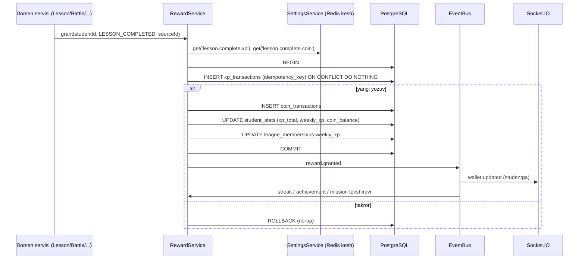
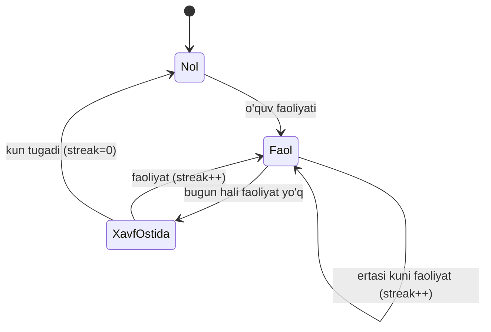
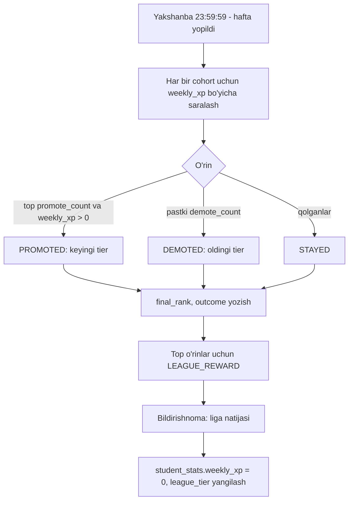

# 04. Gamifikatsiya

> **Qisqa mazmun:** XP va coin farqi, ularning manbalari va sarflanishi, ledger (tranzaksiyalar) yondashuvi, streak qoidalari, kunlik missiya, haftalik liga (ko'tarilish/tushish), sandiqlar, yutuqlar. Barcha raqamlar kodga yozilmaydi, admin sozlamalaridan boshqariladi.

---

## 1. XP va coin

| | **XP** | **Coin** |
|---|---|---|
| Maqsadi | Reyting va liga | Shop'da xarid |
| Kamayadimi? | Yo'q (faqat admin tuzatishi) | Ha, xarid paytida sarflanadi |
| Manfiy bo'ladimi? | Yo'q | Yo'q (balans ≥ 0) |
| Haftalik hisob | Ha (`weekly_xp`, liga uchun) | Yo'q |
| Jadval | `xp_transactions` | `coin_transactions` |
| Agregat | `student_stats.xp_total` | `student_stats.coin_balance` |

### 1.1 Manbalar (qayerdan keladi)

Barcha qiymatlar `reward_settings` dan olinadi. Pastdagi kalitlar sozlama nomlari, ularning qiymatlarini admin belgilaydi.

| Hodisa (`source_type`) | XP kaliti | Coin kaliti | Izoh |
|---|---|---|---|
| `LESSON_COMPLETED` | `lesson.complete.xp` | `lesson.complete.coin` | Har bir dars uchun bir marta |
| `QUESTION_CORRECT_FIRST_TRY` | `question.first_try.xp` | — | Dars savoliga birinchi urinishda to'g'ri javob |
| `TOPIC_COMPLETED` | `topic.complete.xp` | `topic.complete.coin` | Mavzu yakunlanganda |
| `REVIEW_COMPLETED` | `review.complete.xp` | `review.complete.coin` | Takrorlash sessiyasi; natija bo'yicha koeffitsient (`review.score_multiplier`) |
| `WEEKLY_QUIZ_COMPLETED` | `quiz.weekly.xp_per_correct` | `quiz.weekly.coin_bonus` | Bonus faqat ≥ `quiz.weekly.bonus_threshold` % bo'lsa |
| `DAILY_MISSION_COMPLETED` | `mission.<type>.xp` | `mission.<type>.coin` | Har bir missiya uchun |
| `DAILY_ALL_MISSIONS` | `mission.all.xp` | `mission.all.coin` | Kunning barcha missiyalari bajarilganda |
| `STREAK_MILESTONE` | `streak.milestone.<n>.xp` | `streak.milestone.<n>.coin` | Masalan 7, 30, 100 kun |
| `CHEST_OPENED` | sandiq konfiguratsiyasi | sandiq konfiguratsiyasi | 4-bo'limga qarang |
| `BATTLE_WIN / DRAW / LOSS` | `battle.<result>.xp` (bot uchun `battle.bot.<result>.xp`) | `battle.<result>.coin` | Kunlik limit: `battle.daily_xp_cap` |
| `MEETING_ATTENDED` | `meeting.attend.xp` | `meeting.attend.coin` | Mentor "present" deb belgilaganda |
| `PROJECT_REVIEWED` | `project.review.xp_per_point` | `project.review.coin` | Mentor baholaganda |
| `ACHIEVEMENT_UNLOCKED` | yutuq konfiguratsiyasi | yutuq konfiguratsiyasi | |
| `LEAGUE_REWARD` | `league.<tier>.rank_<n>.xp` | `league.<tier>.rank_<n>.coin` | Hafta yakunida top o'rinlar uchun |
| `ADJUSTMENT` | qo'lda | qo'lda | Admin, sabab majburiy |

- **Taxmin:** Bellashuv va davomat ham XP/coin beradi (tavsifda aniq yozilmagan, lekin bellashuvda "natija va XP berish" talab qilingan). → S-40, S-49
- **Taxmin:** Blog posti XP bermaydi (spamni rag'batlantirmaslik uchun). → S-52

### 1.2 Sarflanishi (qayerga ketadi)

| Hodisa | Valyuta | Izoh |
|---|---|---|
| `SHOP_PURCHASE` | Coin (−) | Buyurtma yaratilganda yechiladi |
| `SHOP_REFUND` | Coin (+) | Buyurtma bekor qilinganda qaytariladi |
| `ADJUSTMENT` | XP/coin (±) | Admin tuzatishi |

XP sarflanmaydi.

## 2. Ledger (tranzaksiya) yondashuvi

### 2.1 Tamoyillar
1. **Faqat qo'shiladi (append-only):** tranzaksiya yozuvlari hech qachon `UPDATE/DELETE` qilinmaydi. Xato bo'lsa, teskari (`ADJUSTMENT`) yozuv qo'shiladi.
2. **Idempotentlik:** har bir yozuvda `idempotency_key UNIQUE` bor, masalan `LESSON_COMPLETED:{studentId}:{lessonId}`. Takroriy so'rov ikki marta mukofot bermaydi.
3. **Agregat bitta tranzaksiyada:** `student_stats` ham shu DB tranzaksiyasi ichida yangilanadi.
4. **Coin balansi:** `UPDATE student_stats SET coin_balance = coin_balance - :price WHERE student_id = :id AND coin_balance >= :price`. 0 qator yangilansa, "balans yetarli emas" xatosi qaytariladi. Bu qatorni lock qiladi va poyga holatini (race condition) yo'q qiladi.
5. **`balance_after`:** coin yozuvlarida audit uchun saqlanadi.
6. **Qiymatni muzlatish:** tranzaksiya yozilgan paytdagi sozlama qiymati `amount` ga yoziladi va `meta.settingKey` saqlanadi. Keyin sozlama o'zgarsa, eski yozuvlarga ta'sir qilmaydi.
7. **Rekonsilyatsiya:** tungi job `SUM(transactions)` va `student_stats` ni solishtiradi va farq bo'lsa alert beradi.

### 2.2 Oqim

## 3. Streak

### 3.1 Qoidalar
- **Faol kun:** student o'sha kalendar kunida (Asia/Tashkent) kamida bitta **o'quv faoliyati** bajargan kun: dars yakunlash, takrorlash sessiyasi yoki haftalik quiz.
  - **Taxmin:** Bellashuv, blog va shop faol kun hisoblanmaydi (streak o'qishni rag'batlantirishi kerak). → S-22
- Kun chegarasi: `00:00 Asia/Tashkent`. → S-28
- Faol kun yozilganda: agar `last_active_date = kecha` bo'lsa `current_streak++`, `= bugun` bo'lsa o'zgarmaydi, aks holda `current_streak = 1`.
- `longest_streak = max(longest_streak, current_streak)`.
- Har bir faol kun `activity_days` jadvaliga yoziladi. Bu jadval portfolio va ota-ona panelidagi faollik kalendari uchun ham ishlatiladi.
- Streak uzilishini ko'rsatish lazy usulda bo'ladi: o'qishda `last_active_date < kecha` bo'lsa, ko'rinadigan streak = 0. Tungi job esa `current_streak = 0` ga yozadi va "streak uzildi" bildirishnomasini yuboradi.
- **Eslatma:** kechqurun (masalan 20:00, sozlamadan) bugun faol bo'lmagan va streak > 0 bo'lgan studentlarga "streakingiz uzilmasin" bildirishnomasi yuboriladi.
- **Milestone'lar:** sozlamada ro'yxat bo'ladi, masalan `[3, 7, 14, 30, 60, 100]`, va ularga mukofot beriladi.
- **Taxmin:** "Streak freeze" (bir kunni saqlab qolish) yo'q. Kelajakda shop mahsuloti sifatida qo'shilishi mumkin. → S-23

## 4. Kunlik missiya

- Har kuni student uchun missiyalar to'plami yaratiladi: lazy usulda, kunning birinchi so'rovida yoki 00:05 dagi job orqali.
- Missiya turlari (tavsifdan):

| Tur | Shart | Qachon chiqadi |
|---|---|---|
| `REVIEW` | Bugun muddati kelgan barcha takrorlashlarni bajarish (yoki `mission.review.min_count` tasini) | Muddati kelgan takrorlash bo'lsa |
| `NEW_LESSON` | `mission.new_lesson.count` ta yangi dars yakunlash | Har kuni (yo'lda dars qolgan bo'lsa) |
| `WEEKLY_QUIZ` | Haftalik quizni yakunlash | Quiz ochiq va hali bajarilmagan bo'lsa |

- Progress domen hodisalari bilan yangilanadi (`lesson.completed`, `review.finished`, `quiz.finished`).
- Mukofot: avtomatik yoki "olish" tugmasi bilan beriladi. **Taxmin:** avtomatik beriladi, UI'da animatsiya ko'rsatiladi. → S-26
- Barcha missiyalar bajarilsa, `DAILY_ALL_MISSIONS` bonusi beriladi.

## 5. Haftalik liga

### 5.1 Tuzilma
- **Tierlar (Taxmin → S-24):** Bronza → Kumush → Oltin → Platina → Olmos. Ular admin sozlamasida (`league_tiers` jadvali) belgilanadi, nomi, tartibi va ko'tarilish/tushish soni bilan.
- **Cohort:** har hafta har bir tier ichida studentlar `league.cohort_size` (Taxmin: 30) kishilik guruhlarga bo'linadi. Reyting cohort ichida, **o'sha haftadagi XP** bo'yicha hisoblanadi.
- **Taxmin:** Ligalar butun platforma bo'yicha bo'ladi, guruh yoki yo'l bo'yicha emas. → S-25
- Yangi student eng past tierdan boshlaydi.
- Cohort birinchi XP olinganda belgilanadi, ya'ni faol bo'lmagan studentlar cohort'larni "o'lik" qilmaydi.

### 5.2 Hafta yakuni (Dushanba 00:00 Asia/Tashkent, job)

- Teng XP bo'lsa, birinchi bo'lib shu XP'ga erishgan student yuqorida turadi (`last_xp_at` bo'yicha).
- Eng yuqori tierda ko'tarilish va eng pastki tierda tushish yo'q.
- Haftada 0 XP olgan student tushadi (eng pastki tierdan tashqari).
- Real-time jadval Redis Sorted Set'da saqlanadi: `league:{cohortId}` (score = weekly_xp). DB'dagi `league_memberships` asosiy manba (source of truth) bo'lib qoladi.

## 6. Sandiqlar

- Ilm yo'lida mavzular orasiga joylashtiriladi (`path_chests`: `section_id`, `after_topic_id`).
- **Holatlar:** `LOCKED` (oldingi mavzu tugamagan) → `READY` (ochish mumkin) → `OPENED`.
- **Mukofot (Taxmin → S-26):** admin har bir sandiq uchun `{xp_min, xp_max, coin_min, coin_max}` yoki qat'iy qiymat belgilaydi. Tasodifiy qiymat **server tomonida** tanlanadi va `chest_openings` ga yoziladi (idempotent: `CHEST_OPENED:{student}:{chest}`).
- Ochish faqat bir marta bo'ladi.

## 7. Yutuqlar (achievements)

- **Taxmin:** Yutuqlar ro'yxatini admin qoidalar asosida yaratadi. → S-27
- Ta'rif: `code`, `title`, `description`, `icon`, `rule_type`, `threshold`, `xp_reward`, `coin_reward`.
- Qoida turlari (dastlabki to'plam):

| `rule_type` | Misol |
|---|---|
| `STREAK_DAYS` | 7 kunlik streak |
| `TOPICS_COMPLETED` | 10 ta mavzu |
| `LESSONS_COMPLETED` | 50 ta dars |
| `BATTLES_WON` | 10 ta g'alaba |
| `PERFECT_QUIZ` | Haftalik quizda 100% |
| `LEAGUE_REACHED` | Oltin ligaga chiqish |
| `XP_TOTAL` | 10 000 XP |
| `PROJECTS_REVIEWED` | 3 ta baholangan loyiha |

- Tekshiruv hodisaga asoslangan: `AchievementService` tegishli hodisalarni tinglaydi va faqat shu `rule_type` larni tekshiradi.
- Ochilgan yutuqlar portfolio va ota-ona panelida ko'rinadi.

## 8. Sozlamalar (admin boshqaradi)

- Saqlanishi: `reward_settings` (`key`, `value jsonb`, `description`, `updated_by`, `updated_at`) va tarix uchun `setting_changes`.
- Kesh: Redis `settings:all`. O'zgarganda invalidatsiya qilinadi (pub/sub) va har bir API instansiyasi yangi qiymatni oladi.
- Validatsiya: har bir kalit uchun sxema (Zod/class-validator) bo'ladi, masalan son, ≥ 0, max chegarasi bilan.
- Sozlama guruhlari: `lesson`, `topic`, `question`, `review`, `quiz`, `mission`, `streak`, `battle`, `league`, `meeting`, `project`, `shop`.
- Seed'da boshlang'ich qiymatlar beriladi. Ular faqat start uchun, keyin admin o'zgartiradi.

## 9. Anti-abuse

- Idempotency key'lar (yuqorida).
- Bir xil raqib bilan bellashuvlar uchun kunlik XP limiti (`battle.same_opponent_daily_cap`).
- Darsni "yakunlash" uchun minimal vaqt (`lesson.min_read_seconds`). **Taxmin**, ixtiyoriy. → S-31
- Takrorlashda allaqachon bajarilgan sessiya qayta mukofot bermaydi.

---

## Ochiq savollar (shu modul)

- **S-22** Streak uchun qaysi faoliyatlar hisoblanadi (bellashuv, blog ham kiradimi)?
- **S-23** "Streak freeze" kerakmi (masalan shop mahsuloti sifatida)?
- **S-24** Liga tierlari nomlari, cohort hajmi, nechta student ko'tariladi/tushadi?
- **S-25** Ligalar butun platforma bo'yicha bo'ladimi yoki guruh/yo'l ichidami?
- **S-26** Sandiq ichida nima bo'ladi (qat'iy yoki tasodifiy XP/coin, boshqa narsa)? Missiya mukofoti avtomatik beriladimi?
- **S-27** Yutuqlarning boshlang'ich ro'yxati qanday bo'lsin?
- **S-28** Kun va hafta chegarasi: Asia/Tashkent, hafta dushanbadan boshlanadimi?
- **S-29** Admin qo'lda XP/coin qo'shishi/ayirishi mumkinmi?
- **S-40** Bellashuv uchun XP/coin beriladimi, bot bilan o'yin kamroq beradimi, kunlik limit bormi?
- **S-49** Meetingda qatnashish XP/coin beradimi?
- **S-52** Blog faolligi XP beradimi?
