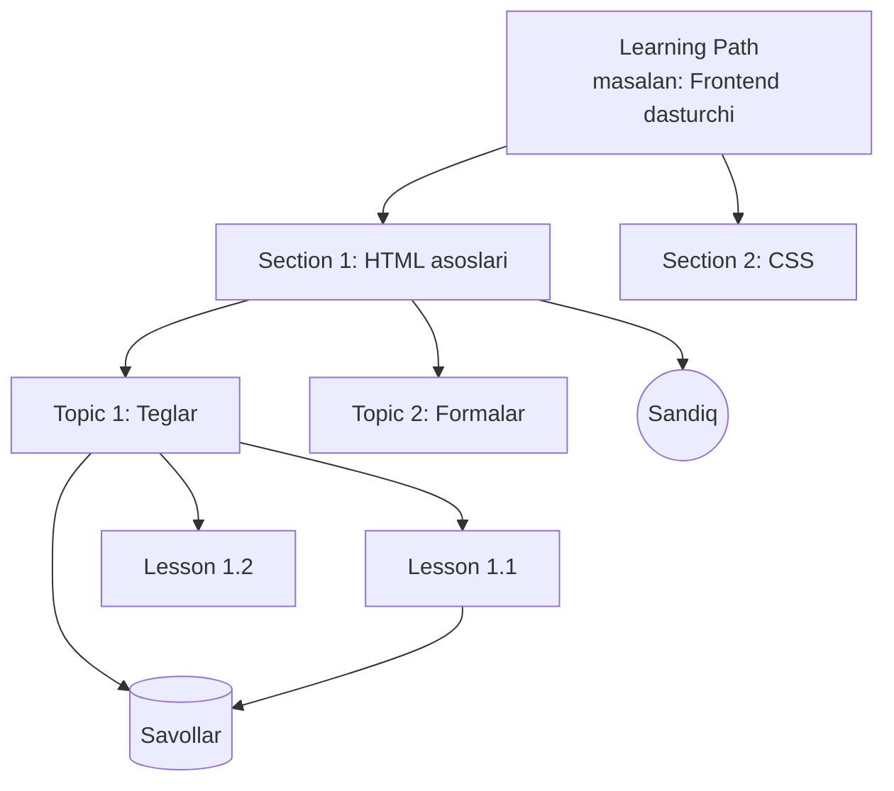
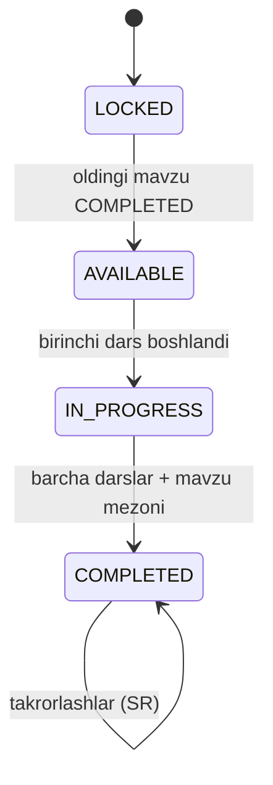
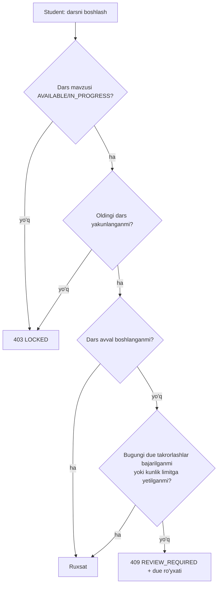
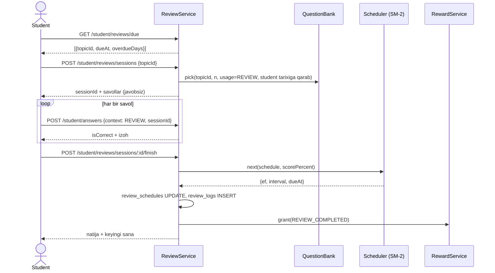

# 05. Ilm yo'li, takrorlash va savollar bazasi

> **Qisqa mazmun:** Ilm yo'li tuzilmasi (yo'l → bo'lim → mavzu → dars), mavzular qachon ochilishi, progress hisoblash, spaced repetition algoritmi (tavsiya va asoslash), haftalik quiz va yagona savollar bazasining tuzilmasi.

---

## 1. Ilm yo'li tuzilmasi



| Daraja | Ma'nosi | Asosiy maydonlar |
|---|---|---|
| **Path (yo'l)** | Uzun o'quv yo'li ("kurs" o'rniga) | `title`, `slug`, `description`, `cover`, `status` (DRAFT/PUBLISHED/ARCHIVED) |
| **Section (bo'lim)** | Yo'lning katta bosqichi, xaritada vizual blok | `path_id`, `order`, `title` |
| **Topic (mavzu)** | Zanjirdagi tugun. Takrorlash va progress birligi | `section_id`, `order`, `title`, `icon`, `skills[]` |
| **Lesson (dars)** | Matnli dars (Markdown) + ixtiyoriy video havola | `topic_id`, `order`, `title`, `content_md`, `video_url`, `est_minutes` |
| **Chest (sandiq)** | Mavzular orasidagi mukofot | `section_id`, `after_topic_id`, `reward config` |
| **Question** | Savollar bazasidagi savol | `topic_id`, `lesson_id?` |

- **Taxmin:** Bo'lim (section) darajasi qo'shildi. Tavsifda faqat "mavzular zanjiri" bor, lekin bu daraja xaritani bloklarga bo'lish va sertifikat berish uchun qulay. → S-01
- Xaritada mavzular bitta chiziqli zanjir bo'lib ketadi (tarmoqlanish yo'q). Tartib `section.order` va `topic.order` bilan belgilanadi.
- **Taxmin:** Bir nechta yo'l bo'lishi mumkin. Student `student_path_enrollments` orqali yo'lga yoziladi va guruh yo'lidan avtomatik biriktiriladi. → S-01

### 1.1 Kontent nashr qilinishi
- Admin `DRAFT` holatda tahrirlaydi. `PUBLISHED` bo'lganidan keyin studentlarga ko'rinadi.
- Nashr qilingan yo'lga yangi mavzu qo'shish mumkin, u zanjir oxiriga yoki o'rtasiga qo'yiladi.
- **Taxmin:** Mavzu o'rtaga qo'shilsa, undan keyingi mavzularni tugatgan studentlar uchun yangi mavzu `AVAILABLE` bo'ladi va keyingi mavzular qulflanmaydi. Allaqachon ochilgan narsa qayta yopilmaydi. → S-35
- **Taxmin:** Dars matni o'zgarsa, studentning progressi saqlanadi (versiyalash yo'q, faqat `updated_at`). → S-35

## 2. Ochilish qoidalari

### 2.1 Mavzu holatlari



- Yo'ldagi birinchi mavzu darhol `AVAILABLE` bo'ladi.
- Mavzu ichida darslar ketma-ket ochiladi (`lesson N+1` → `lesson N` yakunlangandan keyin).
- **Mavzu yakunlanishi (Taxmin → S-31):** barcha darslar yakunlangan va mavzu savollaridan (dars savollari yig'indisi) birinchi urinishda kamida `topic.pass_threshold` % (masalan 70%) to'g'ri bo'lishi kerak. Agar past bo'lsa, mavzu baribir yakunlanadi, lekin SR boshlang'ich holati "qiyin" bo'ladi (qisqa interval). Bu studentni to'xtatib qo'ymaydi.
- **Taxmin:** "Test orqali o'tkazib yuborish" (test-out) yo'q. → S-36

### 2.2 "Yangi dars takrorlashdan keyin ochiladi"
Tavsifdagi bu qoida quyidagicha talqin qilinadi:

- **Qaror (S-30, egasi tasdiqlagan):** Studentda **bugun muddati kelgan (due) takrorlashlar** bo'lsa, yangi darsni (oldin boshlanmagan) boshlash bloklanadi. Avval takrorlashlar bajariladi. Xaritada yangi dars ustida "Avval takrorlang (N ta)" belgisi chiqadi.
  - Boshlangan darsni tugatishga ruxsat beriladi.
  - Kechikkan takrorlashlar ko'p yig'ilib qolsa ham student "qamalib qolmasligi" uchun **kunlik takrorlash limiti admin sozlamasidan** (`review.daily_max`) olinadi. Limit bajarilgach, qolgan due'lar ertaga o'tadi va yangi dars ochiladi.

### 2.3 Yangi dars boshlash tekshiruvi



## 3. Progress hisoblash

| Ko'rsatkich | Formula |
|---|---|
| Mavzu progressi | `yakunlangan darslar / jami darslar` |
| Bo'lim progressi | `yakunlangan mavzular / jami mavzular` |
| Yo'l progressi (yuqoridagi %) | `yakunlangan mavzular / jami nashr qilingan mavzular` |
| O'zlashtirilgan mavzu (portfolio) | `COMPLETED` va SR `repetitions ≥ mastery.min_reps` (masalan 3) va oxirgi takrorlash natijasi ≥ 80% |
| 1-urinishdagi to'g'ri javob % | `first_attempt AND is_correct` / `first_attempt` (barcha kontekstlar yoki faqat dars + takrorlash) |

- Darajalar bo'yicha hisoblar `topic_progress` va `lesson_progress` jadvallarida materiallashtiriladi (har safar sanalmaydi).
- `GET /student/path` javobi butun xaritani qaytaradi. U studentga mos holda Redis'da keshlanadi va progress o'zgarganda invalidatsiya qilinadi.

## 4. Spaced repetition

### 4.1 Takrorlash birligi
- Birlik **mavzu** (tavsif: "har bir mavzu bo'yicha keyingi takrorlash vaqtini hisoblaydi"), alohida savol emas.
- Takrorlash sessiyasi: mavzu savollaridan `review.questions_per_session` ta (masalan 5) tanlanadi. Avval oldin xato qilingan va kamroq ko'rilgan savollar olinadi, ozroq tasodifiylik bilan.
- Sessiya natijasi (to'g'ri %) baho (grade) ga aylantiriladi.

### 4.2 Algoritm tanlovi

| Algoritm | Afzallik | Kamchilik |
|---|---|---|
| **Leitner** (qutilar) | Juda oddiy | Moslashuvchan emas, qiyinlik hisobga olinmaydi |
| **SM-2** (SuperMemo/Anki klassik) | Oddiy, mashhur, tushunarli, mavzu darajasiga oson moslashadi, kam ma'lumot bilan ishlaydi | Optimal emas, "ease hell" muammosi bor |
| **FSRS** (Anki'ning yangi algoritmi) | Eng aniq, unutish egri chizig'iga asoslangan | Parametrlarni optimallashtirish uchun ko'p tarixiy ma'lumot kerak, murakkabroq, asosan karta (savol) darajasi uchun yaratilgan |

**Tavsiya:** **SM-2 ning mavzu darajasiga moslangan varianti** (MVP uchun). Kodda `ReviewScheduler` interfeysi orqali ajratiladi, shunda kelajakda ma'lumot to'plangach FSRS'ga o'tish mumkin bo'ladi (`review_logs` jadvali FSRS optimizatori uchun kerakli tarixni saqlaydi).

Sabablari:
1. Takrorlash birligi mavzu va har bir sessiya bir nechta savoldan iborat. Natija foiz ko'rinishida bo'ladi va SM-2'ning 0–5 bahosiga tabiiy o'tadi.
2. Platforma yangi, tarixiy ma'lumot yo'q, shuning uchun FSRS'ning afzalligi boshida sezilmaydi.
3. Hisoblash deterministik va tushuntirsa bo'ladi ("keyingi takrorlash 6 kundan keyin, chunki...").

### 4.3 Moslangan SM-2

Holat (`review_schedules`): `ease_factor` (EF, boshlang'ich 2.5), `interval_days`, `repetitions`, `lapses`, `due_at`.

**Natijani bahoga aylantirish** (chegaralar sozlamada):

| Sessiyadagi to'g'ri % | Baho `q` |
|---|---|
| 100% | 5 |
| 80–99% | 4 |
| 60–79% | 3 |
| 40–59% | 2 |
| 20–39% | 1 |
| <20% | 0 |

**Hisoblash:**
```
agar q >= 3:
    agar repetitions == 0: interval = 1
    agar repetitions == 1: interval = 3        # klassik SM-2 da 6; mavzu uchun qisqaroq (sozlama)
    aks holda:             interval = round(interval * EF)
    repetitions += 1
aks holda:
    repetitions = 0
    interval = 1
    lapses += 1

EF = EF + (0.1 - (5 - q) * (0.08 + (5 - q) * 0.02))
EF = max(1.3, EF)
interval = min(interval, review.max_interval_days)   # masalan 180
due_at = bugun(Asia/Tashkent) + interval kun
```

- **Birinchi rejalashtirish:** mavzu yakunlanganda `repetitions=0` va mavzu savollari natijasidan `q` hisoblanadi, birinchi takrorlash ertaga bo'ladi.
- **Kechikkan takrorlash:** sessiya kechikib bajarilsa va `q ≥ 4` bo'lsa, intervalni kechikish hisobiga biroz uzaytirish mumkin (FSRS g'oyasi). **Taxmin:** MVP'da qo'llanmaydi.
- **Kunlik limit:** `review.daily_max`. Undan ko'p due bo'lsa, eng kechikkan va eng past EF'lilar birinchi navbatda ko'rsatiladi.

### 4.4 Takrorlash oqimi



## 5. Haftalik quiz

- **Taxmin (→ S-33):**
  - Har dushanba 00:00 da ochiladi va yakshanba 23:59 da yopiladi (Asia/Tashkent).
  - Tarkibi: o'tgan haftada **va undan oldin** yakunlangan mavzulardan `quiz.weekly.question_count` (masalan 15) ta savol. Ulardan 60% o'tgan hafta mavzularidan, 40% eski mavzulardan olinadi.
  - Har student uchun alohida generatsiya qilinadi, chunki studentlar progressi har xil.
  - Bitta urinish beriladi, vaqt limiti `quiz.weekly.time_limit_minutes`.
  - Agar student yetarli mavzuni tugatmagan bo'lsa (`< quiz.weekly.min_topics`), quiz unga chiqmaydi.
- Natija: to'g'ri javoblar soni bo'yicha XP, bonus esa chegaradan yuqori bo'lsa (04). Quiz natijasi mavzular SR'iga ham ta'sir qiladi (ixtiyoriy, sozlama orqali).
- Kunlik missiyaga `WEEKLY_QUIZ` sifatida chiqadi.

## 6. Savollar bazasi

### 6.1 Tamoyil
**Bitta bank**, 4 ta iste'molchi: dars, takrorlash, quiz va bellashuv. Har bir savol mavzuga bog'langan (majburiy) va darsga bog'lanishi ixtiyoriy.

### 6.2 Savol turlari (Taxmin → S-34)

| `type` | Tavsif | Javob formati | Bellashuvga mos |
|---|---|---|---|
| `SINGLE_CHOICE` | Bitta to'g'ri variant | `{optionId}` | ✔ |
| `MULTIPLE_CHOICE` | Bir nechta to'g'ri variant | `{optionIds[]}` | ✔ |
| `TRUE_FALSE` | To'g'ri/noto'g'ri | `{value}` | ✔ |
| `SHORT_TEXT` | Qisqa javob (normalizatsiya bilan solishtiriladi) | `{text}` | Taxmin: ✘ |
| `ORDERING` | Elementlarni tartiblash | `{order[]}` | ✘ |
| `CODE_OUTPUT` | "Bu kod nima chiqaradi?" (variantli) | `{optionId}` | ✔ |

- **Taxmin:** Kod yozib avtomatik tekshiriladigan vazifalar hozircha yo'q. → S-32, S-44

### 6.3 Savol maydonlari
- `topic_id` (majburiy), `lesson_id` (ixtiyoriy).
- `type`, `prompt_md` (Markdown, kod bloklari bilan), `explanation_md` (javobdan keyin ko'rsatiladi).
- `difficulty` (1–3), `time_limit_sec` (bellashuv uchun, ixtiyoriy).
- `usage` flaglari: `in_lesson`, `in_review`, `in_quiz`, `in_battle` (default barchasi `true`, `in_battle` faqat mos turlar uchun).
- `status`: `DRAFT / ACTIVE / ARCHIVED`. Javob berilgan savol o'chirilmaydi, faqat arxivlanadi, chunki tarix va statistika buzilmasligi kerak.
- `options[]`: `text_md`, `is_correct`, `order`. `SHORT_TEXT` uchun `accepted_answers[]`.
- Statistika (materiallashtirilgan): `attempts_count`, `correct_count`. Bu orqali admin juda oson yoki juda qiyin savollarni ko'radi.

### 6.4 Javoblarni qayd qilish
- Barcha kontekstlar uchun bitta jadval: `question_attempts` (`context`: LESSON/REVIEW/QUIZ/BATTLE, `context_id`, `answer jsonb`, `is_correct`, `is_first_attempt`, `time_ms`).
- `is_first_attempt` — student shu savolga umrida birinchi marta javob berayaptimi. Portfolio'dagi "1-urinishdagi to'g'ri javob %" shundan olinadi.
- To'g'ri javob server tomonida tekshiriladi. Frontend'ga savol yuborilganda `is_correct` maydonlari olib tashlanadi.
- Dars ichida xato javobdan keyin qayta urinishga ruxsat beriladi (mukofot faqat 1-urinishda). Takrorlash, quiz va bellashuvda bitta urinish.

### 6.5 Savol tanlash (umumiy servis)
`QuestionPicker.pick({ studentId, topicIds, usage, count, excludeIds, strategy })`:
- **LESSON:** dars savollari, belgilangan tartibda.
- **REVIEW:** mavzu savollari. Vazn beriladi: avval xato qilinganlar, uzoq vaqt ko'rilmaganlar.
- **QUIZ:** yuqoridagi taqsimot bo'yicha mavzulardan tasodifiy, qiyinlik aralash.
- **BATTLE:** ikkala o'yinchi tugatgan mavzular kesishmasidan, faqat `in_battle` savollar (06).

---

## Ochiq savollar (shu modul)

- **S-30** "Yangi dars takrorlashdan keyin ochiladi" aniq qanday ishlaydi: bugungi barcha due takrorlashlar bajarilishi kerakmi?
- **S-31** Mavzu qachon "yakunlangan" hisoblanadi (o'tish foizi bormi)? Dars uchun minimal o'qish vaqti kerakmi?
- **S-32** Darsdagi "vazifalar" faqat savollarmi yoki kod vazifalari ham bormi?
- **S-33** Haftalik quiz jadvali, savollar soni, vaqt limiti va urinishlar soni qanday?
- **S-34** Qaysi savol turlari kerak?
- **S-35** Nashr qilingan kontent o'zgarganda studentlar progressi bilan nima bo'ladi?
- **S-36** Bilimdon student test orqali mavzularni o'tkazib yubora oladimi?
