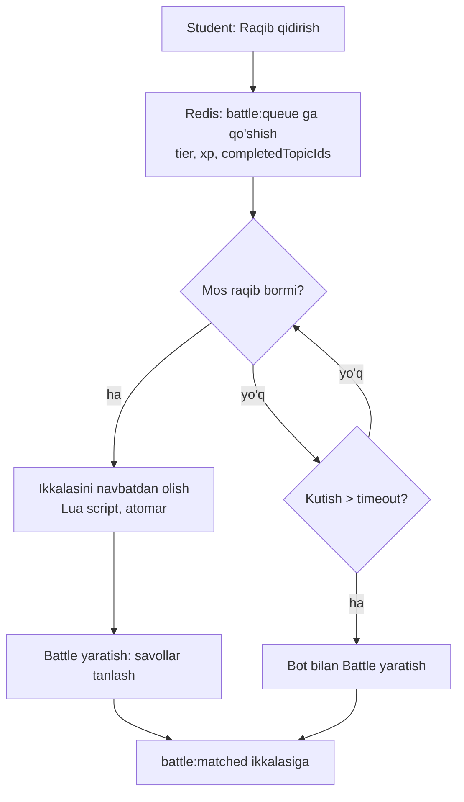
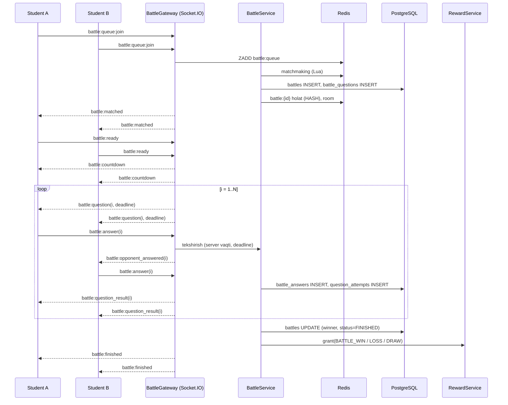
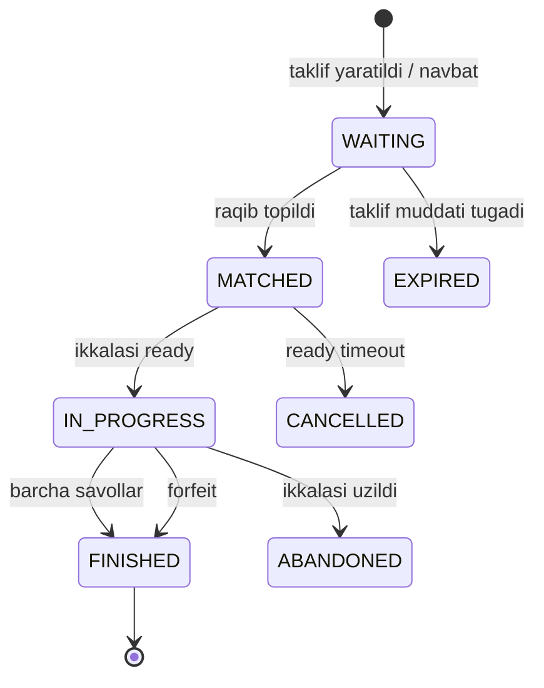

# 06. Bellashuv (1v1 battle)

> **Qisqa mazmun:** Studentlar o'rtasida real-time 1 ga 1 bellashuv: tasodifiy raqib qidirish, do'st bilan o'ynash, raqib bo'lmasa bot. Savollar o'tilgan mavzulardan olinadi. Socket.IO oqimi, uzilish holatlari, natija va mukofot.

---

## 1. Rejimlar

| Rejim | `mode` | Tavsif |
|---|---|---|
| Tasodifiy | `RANDOM` | Matchmaking navbati orqali raqib topiladi |
| Do'st bilan | `FRIEND` | Taklif kodi yoki havola orqali |
| Bot | `BOT` | Belgilangan vaqtda raqib topilmasa, avtomatik bot bilan |

- **Taxmin:** Platformada "do'stlar ro'yxati" yo'q. Do'st bilan o'ynash qisqa **taklif kodi/havola** orqali bo'ladi (masalan `K7P2QX`, 10 daqiqa amal qiladi). Kodni chat, guruh yoki og'zaki orqali ulashish mumkin. → S-37

## 2. O'yin qoidalari (Taxmin → S-38)

Barcha qiymatlar sozlamalardan (`battle.*`) olinadi:

| Parametr | Kalit | Boshlang'ich taklif |
|---|---|---|
| Savollar soni | `battle.question_count` | 7 |
| Har savolga vaqt | `battle.question_time_sec` | 15 s |
| Ball | `battle.points.correct` + tezlik bonusi | 100 + `round(50 × qolgan_vaqt / umumiy_vaqt)` |
| Matchmaking kutish | `battle.matchmaking_timeout_sec` | 20 s, keyin bot |
| Reconnect muddati | `battle.reconnect_grace_sec` | 20 s |

- Ikkala o'yinchi bir vaqtning o'zida bir xil savolni oladi.
- Har savol uchun bitta javob beriladi, o'zgartirib bo'lmaydi.
- Savol tugaydi: ikkalasi ham javob berganda yoki vaqt tugaganda. So'ng to'g'ri javob va ikkala o'yinchining natijasi ko'rsatiladi (3 s pauza).
- G'olib — ballari ko'p o'yinchi. Teng bo'lsa `DRAW`.

## 3. Savollarni tanlash

1. Har bir o'yinchi uchun `COMPLETED` holatdagi mavzular to'plami olinadi: `A` va `B`.
2. `I = A ∩ B` (kesishma). Undan faqat `in_battle = true` va `status = ACTIVE` savollar tanlanadi.
3. Agar `I` dagi savollar soni `battle.question_count` dan kam bo'lsa:
   - **RANDOM:** bu juftlik matchmaking'da mos emas deb hisoblanadi va boshqa raqib qidiriladi.
   - **FRIEND:** kesishma yetarli bo'lmasa, "Umumiy mavzular yetarli emas" xatosi chiqadi. **Taxmin:** yetarli bo'lmagan qism taklif qilgan o'yinchining mavzularidan to'ldirilmaydi. → S-39
4. Tanlov: turli mavzulardan, qiyinlik aralash, oxirgi N ta bellashuvda kelgan savollar chiqarib tashlanadi.
5. **BOT:** studentning o'z `COMPLETED` mavzularidan.
6. Hech bir mavzusi tugallanmagan student bellashuvga kira olmaydi ("Kamida N ta mavzu tugating", `battle.min_completed_topics`).

## 4. Matchmaking

- **Moslik mezoni:** bir xil yoki qo'shni liga tieri, umumiy savollar yetarli. Kutish uzaygan sari mezon kengaytiriladi.
- Navbat Redis'da saqlanadi (ZSET + har o'yinchi uchun hash), matchmaking worker har 1 s da yuradi. Juftlash atomar bo'lishi uchun Lua script ishlatiladi, shunda bitta studentni ikki marta juftlab qo'yish imkoni bo'lmaydi.
- Bir student bir vaqtda faqat bitta faol bellashuvda yoki navbatda bo'la oladi (`battle:active:{studentId}`).

## 5. Bot

- **Taxmin:** Bot "o'zini real o'yinchidek" ko'rsatmaydi, UI'da "Bot" deb aniq yoziladi. → S-40
- Bot darajasi studentning haftalik/umumiy aniqligiga qarab tanlanadi (`bot.accuracy` ≈ student aniqligi ± 10%).
- Bot xatti-harakati server tomonida simulyatsiya qilinadi: har savolga `random(3..12) s` kechikish bilan, `accuracy` ehtimolligi bilan to'g'ri javob beradi.
- Bot bilan o'yin uchun mukofot alohida sozlanadi (`battle.bot.<result>.xp`, odatda kamroq).

## 6. Real-time oqim (Socket.IO)

Namespace: `/battle`. Ulanish access token bilan.

### 6.1 Eventlar

| Yo'nalish | Event | Payload |
|---|---|---|
| C → S | `battle:queue:join` | `{}` |
| C → S | `battle:queue:leave` | `{}` |
| C → S | `battle:invite:join` | `{code}` |
| S → C | `battle:matched` | `{battleId, opponent:{name, avatar, tier, isBot}, questionCount}` |
| C → S | `battle:ready` | `{battleId}` |
| S → C | `battle:countdown` | `{startsAt}` |
| S → C | `battle:question` | `{index, question (javobsiz), deadline}` |
| C → S | `battle:answer` | `{battleId, index, answer}` |
| S → C | `battle:opponent_answered` | `{index}` (natijasiz) |
| S → C | `battle:question_result` | `{index, correctAnswer, you:{correct, points}, opponent:{correct, points}, score}` |
| S → C | `battle:opponent_disconnected` | `{graceUntil}` |
| S → C | `battle:opponent_reconnected` | `{}` |
| S → C | `battle:finished` | `{result, score, rewards:{xp, coin}}` |
| C → S | `battle:resume` | `{battleId}` (reconnect'dan keyin) |
| S → C | `battle:state` | to'liq joriy holat (resume javobi) |
| S → C | `battle:error` | `{code, message}` |

### 6.2 Sequence

### 6.3 Server — yagona haqiqat manbai
- Savol taymeri **serverda** ishlaydi. Klient vaqti hisobga olinmaydi va `deadline` server vaqti bilan beriladi.
- To'g'ri javob klientga faqat `question_result` da yuboriladi.
- Socket.IO bir nechta instansiyada ishlashi uchun `@socket.io/redis-adapter` ishlatiladi. Bellashuv holati Redis'da saqlanadi, savol taymerlari esa `BullMQ` delayed job yoki battle egasi bo'lgan instansiya orqali boshqariladi (lock: `battle:{id}:owner`).

## 7. Uzilib qolish holatlari

| Holat | Xatti-harakat |
|---|---|
| O'yinchi `matched` dan keyin `ready` bermadi (10 s) | Bellashuv `CANCELLED` bo'ladi, ikkinchi o'yinchi navbatga qaytariladi, mukofot yo'q |
| O'yin davomida uzildi | Raqibga `opponent_disconnected` yuboriladi. Grace muddati (20 s) ichida savollar davom etadi, javob berilmagan savollar 0 ball |
| Grace ichida qaytdi | `battle:resume` → `battle:state`, o'yin davom etadi |
| Grace tugadi | Uzilgan o'yinchi **mag'lub** (`FORFEIT`), qolgani g'olib. G'olib to'liq g'alaba mukofotini oladi |
| Ikkalasi ham uzildi | `ABANDONED`, mukofot yo'q |
| Server qayta ishga tushdi | Redis'dagi holatdan tiklanadi. Tiklab bo'lmasa `ABANDONED` |
| Brauzer tabi yopildi / boshqa tab | Bitta student uchun faqat bitta faol socket ishlaydi, yangi ulanish eskisini almashtiradi |
| Ataylab chiqib ketish (spam) | Kunlik forfeit limiti oshsa, matchmaking vaqtincha bloklanadi (`battle.forfeit_cooldown`) |

## 8. Natija va mukofot

- Natija `battles` (`status`, `winner_id`, `score_p1`, `score_p2`) va `battle_answers` ga yoziladi.
- Har bir javob `question_attempts` ga ham `context=BATTLE` bilan yoziladi (portfolio statistikasi uchun).
- Mukofot `RewardService` orqali beriladi, idempotency key `BATTLE:{battleId}:{studentId}`.
- **Anti-abuse:** bir xil raqib bilan kunlik XP limiti, umumiy kunlik bellashuv XP limiti (`battle.daily_xp_cap`).
- **Taxmin:** Alohida ELO/reyting yo'q, faqat XP va g'alaba/mag'lubiyat statistikasi. → S-41
- Bellashuv natijalarini ota-ona va mentor ko'radi.

## 9. Holat mashinasi

---

## Ochiq savollar (shu modul)

- **S-37** "Do'st" tushunchasi: do'stlar ro'yxati kerakmi yoki taklif kodi/havola yetarlimi?
- **S-38** Bellashuvda nechta savol, har biriga qancha vaqt, ball qanday hisoblanadi?
- **S-39** Do'stlarning umumiy o'tilgan mavzulari yetarli bo'lmasa nima qilinadi?
- **S-40** Bot qanday ko'rinadi (bot ekani aniq ko'rsatiladimi)? Bot bilan o'yinda mukofot qancha?
- **S-41** Bellashuv uchun alohida reyting (ELO) kerakmi?
