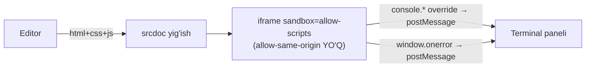
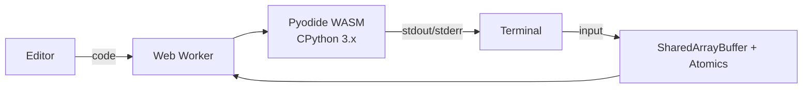
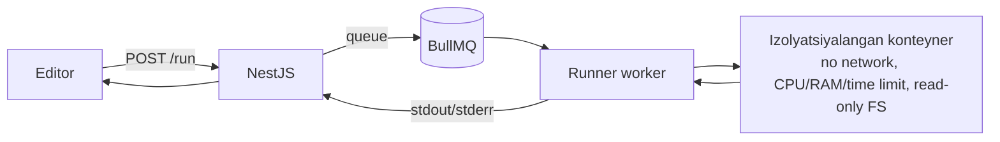

# 07. Kod maydoni (playground)

> **Qisqa mazmun:** HTML/CSS/JS va Python kodini ishga tushirish variantlari (brauzerda: sandbox iframe, Pyodide; serverda: izolyatsiyalangan sandbox), ularning afzallik va xavflari hamda tavsiya.

---

## 1. Talablar (tavsifdan)
- Onlayn editor: **HTML, CSS, JS, Python**.
- **Natija oynasi** (web uchun) va **terminal oynasi** (JS console, Python stdout/stderr).

**Qo'shimcha (Taxmin):**
- Snippetlarni saqlash (`code_snippets`). → S-43
- Darsdagi kod blokini "Kod maydonida ochish". → S-43
- Python'da `input()` ishlashi kerak (boshlang'ichlar uchun muhim). → S-42
- Avtomatik baholash (test-case) **hozircha yo'q**. → S-44

## 2. Editor
- **CodeMirror 6** (yengil, mobilga yaxshiroq mos) yoki **Monaco** (VS Code tajribasi, lekin og'ir ~ 2–5 MB va mobilda yomon ishlaydi).
- **Tavsiya:** CodeMirror 6. Platformada mobil foydalanuvchilar ko'p bo'lishi kutiladi, editor esa faqat o'quv maqsadida.
- Web uchun tablar: `index.html`, `style.css`, `script.js`. Python uchun bitta fayl `main.py`.
- Avtosaqlash: `localStorage` (draft) va "Saqlash" tugmasi serverga yozadi.

## 3. Ishga tushirish variantlari

### 3.1 HTML/CSS/JS — brauzerda, sandbox iframe

- `<iframe sandbox="allow-scripts allow-modals" srcdoc="...">`. **`allow-same-origin` berilmaydi**, natijada iframe "opaque origin"da ishlaydi va platformaning cookie, localStorage hamda API'lariga kira olmaydi.
- **Yaxshiroq variant:** natijani alohida domenda ochish (`https://run.<domen>` yoki `usercontent` domen). Shunda xatolik bo'lsa ham asosiy domen ta'sirlanmaydi.
- iframe ichiga `CSP` meta qo'yiladi: tashqi so'rovlar cheklanadi (`connect-src 'none'`). **Taxmin:** tashqi CDN'larni (masalan, Bootstrap) ulashga ruxsat kerakmi, bu ochiq savol. → S-42
- `console.log/warn/error` va xatolar `postMessage` orqali terminal paneliga uzatiladi.
- Cheksiz sikl (`while(true)`) iframe va tabni qotirib qo'yadi. Himoya: "Stop" tugmasi iframe'ni qayta yaratadi. Ixtiyoriy ravishda loop protection (kodni AST orqali o'zgartirib, siklga vaqt tekshiruvi qo'shish — CodePen usuli) qo'llanadi.

| Afzallik | Xavf/kamchilik |
|---|---|
| Server yuklamasi 0, darhol ishlaydi | Cheksiz sikl brauzer tabini qotiradi (loop protection bilan kamayadi) |
| Haqiqiy brauzer muhiti (DOM, CSS) | Noto'g'ri sozlansa, XSS xavfi bor (`allow-same-origin` + bir xil domen) |
| Offline ham ishlaydi | Ulashilgan snippetlarda zararli kod bo'lishi mumkin, shuning uchun alohida domen kerak |

### 3.2 Python — brauzerda (Pyodide)

- Pyodide (CPython → WebAssembly) **Web Worker** ichida ishlaydi, shuning uchun UI qotmaydi. Cheksiz siklda worker `terminate()` qilinadi va qayta yaratiladi.
- `input()`: worker ichida sinxron kutish kerak. Buning uchun `SharedArrayBuffer` + `Atomics.wait` ishlatiladi, bu esa saytda `Cross-Origin-Opener-Policy: same-origin` va `Cross-Origin-Embedder-Policy: require-corp` header'larini talab qiladi. Muqobil yo'li — Service Worker orqali sinxron XHR hiylasi.
- Hajmi: birinchi yuklanish ~ 6–10 MB (keyin keshdan). Pyodide CDN yoki o'z serverimizdan (`/static/pyodide/`) beriladi.
- Kutubxonalar: standart kutubxona va Pyodide paketlari (numpy, pandas va h.k. `micropip` orqali).

| Afzallik | Xavf/kamchilik |
|---|---|
| Server xarajati va xavfsizlik xavfi yo'q (kod foydalanuvchi brauzerida ishlaydi) | Birinchi yuklanish og'ir (mobil internetda sekin) |
| Bir vaqtda minglab studentga masshtablanadi | Kuchsiz telefonlarda sekin ishlaydi |
| Worker orqali cheksiz siklni to'xtatish oson | `input()` uchun COOP/COEP header'lari kerak, ular boshqa embed'larga (YouTube iframe) ta'sir qilishi mumkin, shuning uchun bu header'lar faqat `/playground` yo'liga qo'yiladi |
| | Ba'zi modullar ishlamaydi (`threading`, `socket`, `subprocess`) |

### 3.3 Serverda sandbox

Variantlar: **Judge0** (tayyor open-source, ko'p tilli), **Piston**, o'z yechimimiz (Docker + gVisor/Firecracker, `nsjail`).

| Afzallik | Xavf/kamchilik |
|---|---|
| Har qanday til (Java, C++, Go va h.k.) | **Eng katta xavf:** foydalanuvchi kodini serverda bajarish (sandbox'dan qochish, kripto-mayning, DoS) |
| Avtomatik baholash (test-case) uchun ishonchli, chunki natijani klient soxtalashtira olmaydi | Infratuzilma xarajati va doimiy xavfsizlik yangilanishlari |
| Kuchsiz qurilmalarga bog'liq emas | Interaktiv `input()` uchun WebSocket orqali real-time terminal kerak, bu murakkab |
| | Navbat va kechikish (yuklama ostida) |

Server sandbox uchun majburiy choralar: tarmoq yo'q, `--memory`, `--cpus`, `--pids-limit`, vaqt limiti (masalan 5 s), read-only FS, root bo'lmagan foydalanuvchi, seccomp/gVisor, foydalanuvchi bo'yicha rate limit.

## 4. Taqqoslash

| Mezon | Iframe (web) | Pyodide | Server sandbox |
|---|---|---|---|
| Xavfsizlik (platforma uchun) | Yuqori (to'g'ri sozlansa) | Juda yuqori | O'rta (ehtiyotkorlik talab qiladi) |
| Server xarajati | 0 | 0 | Yuqori |
| Masshtablanish | Cheksiz | Cheksiz | Resursga bog'liq |
| Ishga tushish tezligi | Darhol | 1-marta sekin, keyin tez | Tarmoq + navbat kechikishi |
| Kuchsiz qurilmada | Yaxshi | O'rtacha | Yaxshi |
| Avtomatik baholash ishonchliligi | Past | Past | Yuqori |
| Tillar | HTML/CSS/JS | Python | Istalgan |

## 5. Tavsiya

1. **MVP (8-bosqich):** to'liq brauzerda ishlaydi.
   - HTML/CSS/JS uchun **sandbox iframe**, alohida origin'da (`run.` subdomeni), `allow-same-origin` yo'q, loop protection bilan.
   - Python uchun **Pyodide**, Web Worker ichida, `input()` uchun SharedArrayBuffer, COOP/COEP faqat `/playground` yo'lida.
   - Server faqat snippetlarni saqlaydi.
2. **Keyingi bosqich (kerak bo'lsa):** avtomatik baholanadigan kod vazifalari yoki boshqa tillar kerak bo'lganda **Judge0** (self-hosted, alohida server/VM'da, asosiy infratuzilmadan izolyatsiya qilingan) qo'shiladi. Bu S-32/S-44 javobiga bog'liq.

## 6. Ma'lumotlar
- `code_snippets`: `id`, `student_id`, `title`, `language` (`WEB` | `PYTHON`), `files jsonb` (`{"index.html": "...", ...}`), `created_at`, `updated_at`.
- Limitlar: bitta snippet ≤ 200 KB, studentga ≤ 100 ta snippet (sozlama).
- **Taxmin:** Snippetlarni boshqalar bilan ulashish hozircha yo'q. → S-43

---

## Ochiq savollar (shu modul)

- **S-42** Python'da qaysi kutubxonalar va `input()` kerakmi? Web kodda tashqi CDN'larni ulashga ruxsat beriladimi?
- **S-43** Snippetlarni saqlash va ulashish kerakmi? Darsdagi kod bloklaridan playground'ni ochish kerakmi?
- **S-44** Kod yozish vazifalarini avtomatik tekshirish (test-case) kerakmi? Agar kerak bo'lsa, server sandbox qilinadi.
