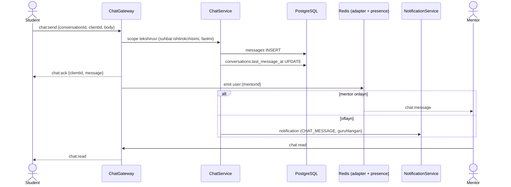
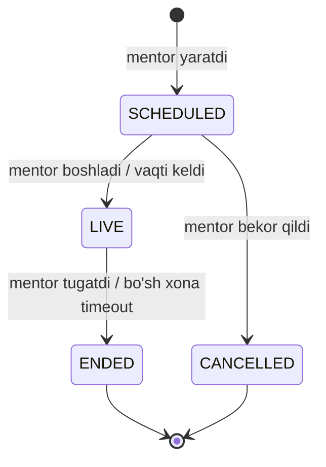
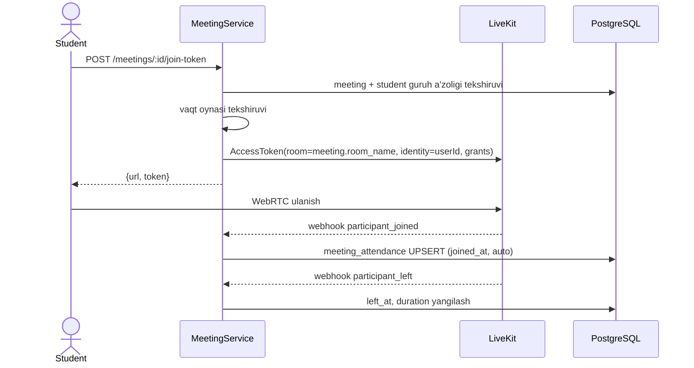

# 08. Mentor: chat, meeting, davomat, materiallar

> **Qisqa mazmun:** Mentor va student o'rtasidagi real-time chat, jonli meetinglar (LiveKit yoki Jitsi taqqoslash va tavsiya), davomat va guruh materiallari. Hammasi mentorning faqat o'z guruhlari bilan cheklanadi.

---

## 1. Chat

### 1.1 Qamrov
- **Taxmin:** Faqat **1:1 mentor ↔ student** chati bo'ladi. Guruh chati va student ↔ student chati yo'q. → S-47
- Student faqat o'z (faol guruhi) mentori bilan yozisha oladi. Mentor faqat o'z guruhlaridagi studentlar bilan.
- Suhbat (`conversations`) juftlik uchun bitta: `UNIQUE(mentor_id, student_id)`. Birinchi xabarda avtomatik yaratiladi.
- Student boshqa guruhga o'tsa, eski suhbat arxivlanadi (`is_archived`): student ko'radi, lekin yoza olmaydi.
- **Taxmin:** Xabarlarga rasm/fayl qo'shish mumkin (≤ 10 MB). Xabarni tahrirlash 15 daqiqa ichida, o'chirish esa "o'chirildi" belgisi bilan (soft) bo'ladi. → S-47

### 1.2 Real-time oqim

Namespace: `/chat` (yoki umumiy `/rt`). Har bir foydalanuvchi ulanganda `user:{id}` xonasiga qo'shiladi.

| Yo'nalish | Event | Payload |
|---|---|---|
| C → S | `chat:send` | `{conversationId, clientId, body, attachmentFileId?}` |
| S → C | `chat:ack` | `{clientId, message}` |
| S → C | `chat:message` | `{message}` |
| C → S | `chat:typing` | `{conversationId}` |
| S → C | `chat:typing` | `{conversationId, userId}` |
| C → S | `chat:read` | `{conversationId, lastMessageId}` |
| S → C | `chat:read` | `{conversationId, userId, lastMessageId}` |

- **Ishonchlilik:** xabar avval DB'ga yoziladi, keyin emit qilinadi. Klient `clientId` (UUID) yuboradi, shu sabab qayta yuborishda dublikat paydo bo'lmaydi (`UNIQUE(sender_id, client_id)`).
- **Tarix:** REST orqali, cursor pagination bilan (`GET /chat/conversations/:id/messages?before=<id>&limit=30`).
- **Reconnect:** klient oxirgi `messageId` dan keyin kelgan xabarlarni REST orqali so'raydi.
- **Presence:** Redis `presence:{userId}` (TTL bilan) mentor/student onlayn holatini ko'rsatadi.
- **Rate limit:** 20 xabar / 10 s.
- **Taxmin:** Chatni faqat super admin ko'ra oladi (audit). → S-48

## 2. Meetinglar

### 2.1 Talablar
- Mentor jonli meeting belgilaydi (sana, vaqt, davomiylik, mavzu).
- Studentlar platformadan qo'shiladi.
- Mentor davomat qiladi.
- **Taxmin:** Meeting **guruh** uchun belgilanadi. 1:1 meeting ham bo'lishi mumkin (`student_id` bilan), lekin bu ixtiyoriy. → S-46
- **Taxmin:** Meetinglar yozib olinmaydi. → S-50

### 2.2 LiveKit va Jitsi taqqoslash

| Mezon | **LiveKit** | **Jitsi Meet** |
|---|---|---|
| Turi | WebRTC SFU + SDK (UI'ni o'zimiz yoki `@livekit/components-react` bilan quramiz) | Tayyor to'liq ilova (UI bilan), iframe/External API orqali embed qilinadi |
| Integratsiya | Server SDK (Node) orqali token beriladi va xonalar boshqariladi | IFrame API; JWT auth uchun `prosody` + `jitsi-jwt` sozlash kerak |
| UI moslashuvchanligi | To'liq (o'z dizaynimiz, bu talabga mos) | Cheklangan (Jitsi interfeysi) |
| Davomat avtomatlashtirish | **Webhooks** (`participant_joined/left`), aniq vaqtlar bilan | IFrame eventlari (klient tomonda, ishonchsiz) yoki Prosody modullari (murakkab) |
| Hosting | LiveKit Cloud (pullik, tez start) yoki self-host (Go binary, TURN kerak) | `meet.jit.si` (bepul, lekin 2023 dan login talab qiladi va embed 5 daqiqaga cheklangan) yoki self-host (Docker) |
| Ishga tushirish tezligi | O'rtacha (UI yozish kerak, tayyor komponentlar mavjud) | Tez (tayyor UI) |
| Masshtab | Yaxshi (SFU, simulcast) | Yaxshi (JVB'lar bilan) |

### 2.3 Tavsiya
**LiveKit** (MVP'da LiveKit Cloud, keyin kerak bo'lsa self-host) tavsiya etiladi. Sabablari:
1. "Dizayn o'zimizniki" talabi: LiveKit React komponentlari bilan to'liq moslashtirilgan UI qurish mumkin.
2. Webhook'lar orqali **ishonchli avtomatik davomat qaydi** olinadi. Mentor uchun oldindan to'ldirilgan davomat ish vaqtini tejaydi.
3. Token'ni bizning backend beradi, shuning uchun meetingga faqat guruh a'zolari kira oladi (RBAC bilan mos).

**Qaror (S-45):** LiveKit tanlandi. Cloud yoki self-host masalasi 10-bosqichda yakuniy tasdiqlanadi.

Kodda `MeetingProvider` interfeysi (`createRoom`, `issueJoinToken`, `endRoom`, `parseWebhook`) orqali provayderdan mustaqil quriladi.

### 2.4 Meeting hayot sikli

- Yaratilganda guruh studentlariga bildirishnoma yuboriladi. Eslatmalar: 1 kun va 15 daqiqa oldin (BullMQ delayed job).
- "Qo'shilish" tugmasi `starts_at - 10 daqiqa` dan faol bo'ladi.

### 2.5 Qo'shilish

- Mentor `roomAdmin` huquqiga ega bo'ladi (mute, chiqarish). Student oddiy huquqlar bilan qo'shiladi.

## 3. Davomat

- Har bir meeting uchun guruhning barcha faol studentlari ro'yxati ko'rsatiladi.
- **Avtomatik taklif:** webhook ma'lumotlari asosida, `joined` va `duration ≥ attendance.min_minutes` bo'lsa `PRESENT`, kech qo'shilgan bo'lsa `LATE`, umuman qo'shilmagan bo'lsa `ABSENT`.
- **Mentor tasdiqlaydi:** statusni o'zgartiradi (`PRESENT / LATE / ABSENT / EXCUSED`), izoh qo'shadi va saqlaydi. Yakuniy qaror mentor qo'lida (tavsif: "davomat qiladi").
- Saqlanganda: `PRESENT`/`LATE` uchun `MEETING_ATTENDED` mukofoti beriladi (idempotent). **Taxmin**, → S-49.
- Davomatni meetingdan keyin `attendance.edit_window_days` ichida tahrirlash mumkin. Keyin faqat admin o'zgartira oladi.
- Ko'rinish: student o'z davomatini ko'radi, ota-ona farzandinikini, mentor guruh foizini, admin hisobotlarda.

## 4. Materiallar

- Mentor o'z guruh(lar)iga material qo'shadi: **fayl** (PDF, rasm, arxiv, ≤ 50 MB) yoki **havola**.
- Maydonlar: `title`, `description`, `type`, `file_id | url`, `group_id`. Bitta material bir nechta guruhga biriktirilishi mumkin (`material_groups`).
- Student o'z guruhining materiallarini ko'radi va yuklab oladi.
- Fayllar object storage'da saqlanadi, yuklab olish uchun qisqa muddatli **pre-signed URL** beriladi (13).
- Yangi material qo'shilganda guruhga bildirishnoma yuboriladi.

## 5. Mentor profili (student ko'radi)
- Ism, avatar, bio, ko'nikmalar/yo'nalish, (ixtiyoriy) ish vaqti.
- **Taxmin:** Mentorning telefon raqami studentga ko'rsatilmaydi. → S-47

---

## Ochiq savollar (shu modul)

- **S-45** Meeting uchun LiveKit yoki Jitsi? Cloud yoki self-host?
- **S-46** Meetinglar faqat guruh uchunmi yoki mentor bitta student bilan ham meeting belgilay oladimi?
- **S-47** Chat qamrovi: faqat 1:1 bo'ladimi, guruh chati kerakmi, fayl yuborish, tahrirlash/o'chirish, mentor telefonini ko'rsatish?
- **S-48** Chatni kim audit qila oladi?
- **S-49** Davomat XP/coin beradimi?
- **S-50** Meetinglar yozib olinadimi?
