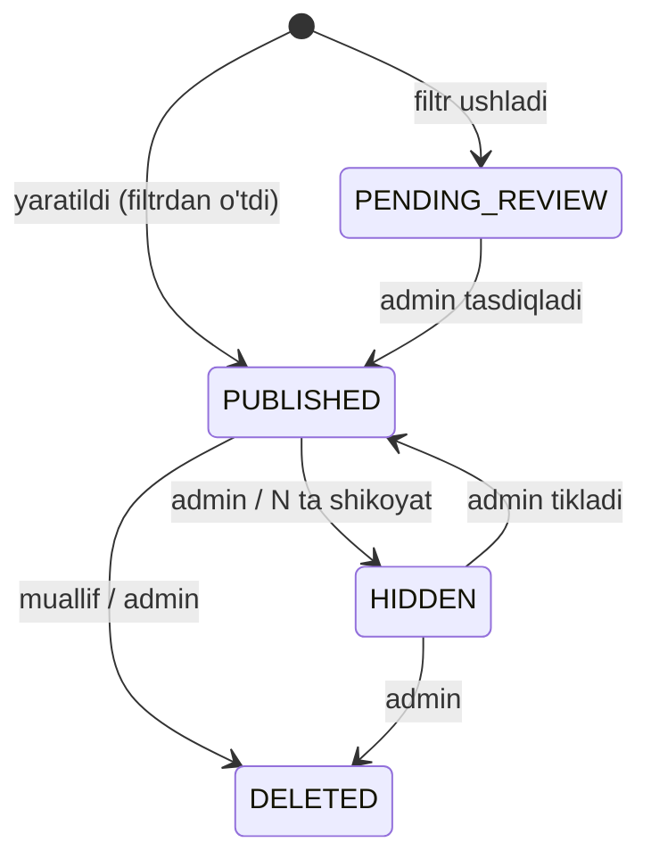
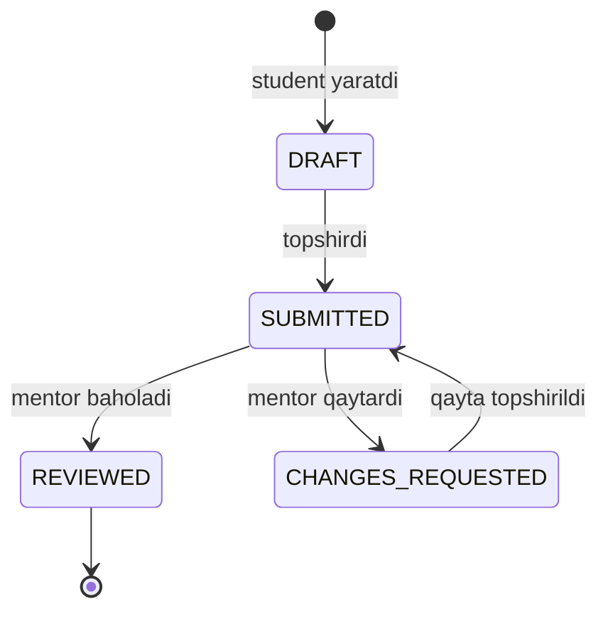
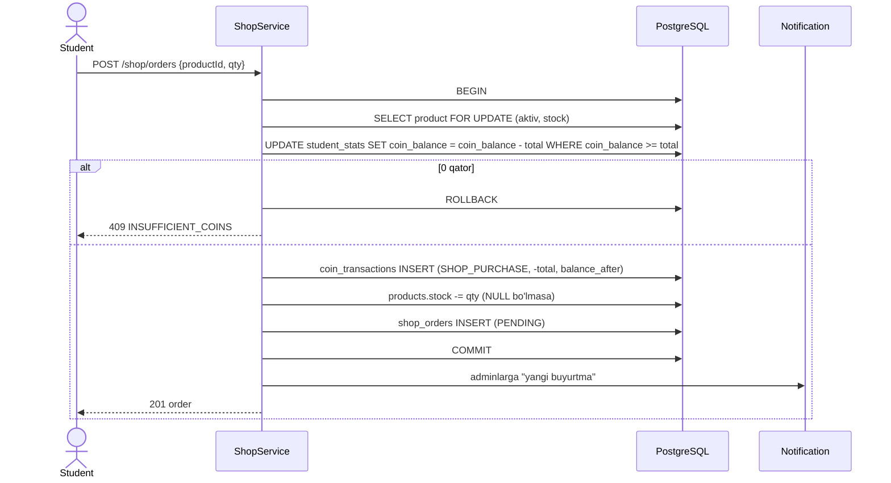
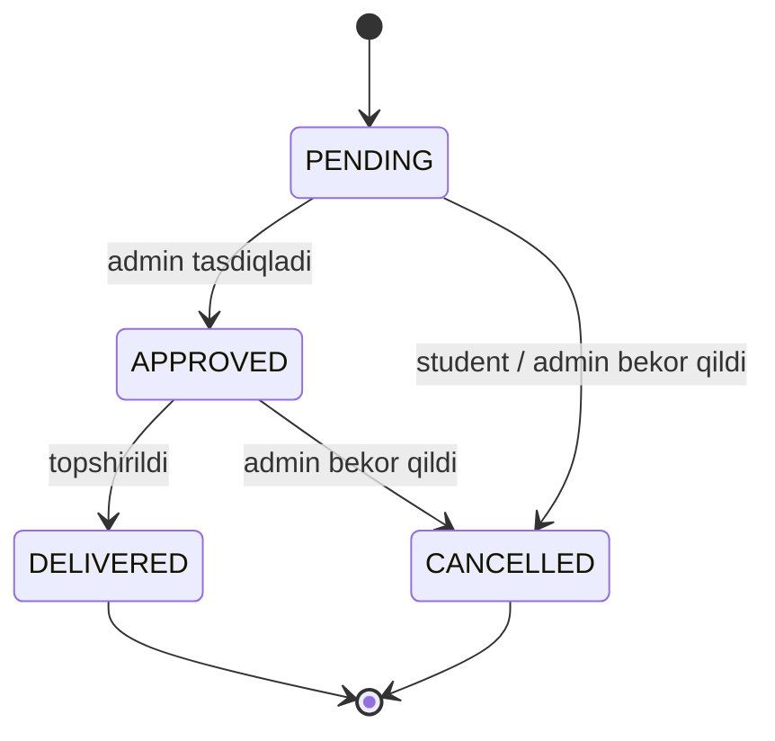

# 09. Blog, portfolio, shop

> **Qisqa mazmun:** Blog (X'ga o'xshash postlar, rasm, like, komment, moderatsiya), portfolio (statistika, grafiklar, ko'nikmalar, loyihalar, yutuqlar, sertifikatlar, ulashish/yuklab olish) va shop (mahsulotlar, buyurtma, coin yechish).

---

## 1. Blog

### 1.1 Post
- Maydonlar: **rasm** (ixtiyoriy, 1 dona. **Taxmin:** bir nechta rasm kerakmi? → S-51), **sarlavha** (≤ 120 belgi), **tavsif/matn** (≤ 2000 belgi, oddiy matn + havolalar, Markdown yo'q).
- Muallif: student (**Taxmin** → S-09).
- Lenta: barcha studentlar uchun umumiy, yangi postlar yuqorida (cursor pagination). **Taxmin:** "guruhim" filtri ham bo'ladi.
- Amallar: yaratish, tahrirlash (muallif), o'chirish (muallif → soft), like/unlike, komment.
- Hisoblagichlar: `like_count`, `comment_count` (denormalizatsiya qilingan, tranzaksiya ichida yangilanadi).

### 1.2 Like va komment
- Like: `blog_likes (post_id, user_id) PRIMARY KEY`, shu sabab ikki marta like bosib bo'lmaydi.
- Komment: ≤ 500 belgi. **Taxmin:** bitta darajali javob (reply, `parent_id`) bo'ladi, chuqur daraxt yo'q. → S-51
- Muallifga bildirishnoma yuboriladi: like (guruhlangan: "5 kishi yoqtirdi") va komment.

### 1.3 Moderatsiya
- **Taxmin:** **Post-moderatsiya** — post darhol chiqadi, keyin shikoyat (report) va admin ko'rib chiqishi bilan nazorat qilinadi. Yosh foydalanuvchilar bo'lishi mumkinligi sababli **pre-moderatsiya** (admin tasdiqlamaguncha ko'rinmaydi) ham variant sifatida turadi. → S-51
- Avtomatik filtr: taqiqlangan so'zlar ro'yxati (admin sozlamasi). Mos kelsa, post `PENDING_REVIEW` holatiga o'tadi.
- Shikoyat: istalgan student post yoki kommentga shikoyat qiladi (sabab: spam, haqorat, nomaqbul kontent, boshqa). N ta shikoyatdan keyin kontent avtomatik yashiriladi (`blog.auto_hide_reports`).
- Admin amallari: `HIDDEN` (yashirish), `PUBLISHED` (tiklash), `DELETED`, shikoyatni yopish, foydalanuvchiga blogda yozishni taqiqlash (`blog_banned_until`).
- Rasmlar: yuklashda MIME/hajm (≤ 5 MB) tekshiriladi, EXIF o'chiriladi, server tomonida resize qilinib WebP'ga o'tkaziladi.

- **Taxmin:** Blog faolligi XP bermaydi. → S-52

## 2. Portfolio

### 2.1 Bloklar va ma'lumot manbalari

| Blok | Tarkib | Manba |
|---|---|---|
| **Umumiy statistika** | O'zlashtirilgan mavzular soni, ko'nikmalar soni, faol kunlar soni, 1-urinishdagi to'g'ri javob % | `topic_progress` + `review_schedules` (05 §3), `student_skills`, `activity_days`, `question_attempts` |
| **O'sish grafigi** | Vaqt bo'yicha kumulyativ XP va yakunlangan mavzular (haftalik nuqtalar) | `xp_transactions` (kunlik agregat), `topic_progress.completed_at` |
| **Kunlik reja** | Bugungi missiyalar va bugun muddati kelgan takrorlashlar | `daily_missions`, `review_schedules` |
| **Faollik kalendari** | GitHub uslubidagi heatmap (kunlik XP intensivligi) | `activity_days` (`date`, `xp`, `actions_count`) |
| **Ko'nikmalar** | Ko'nikma nomi va darajasi (%) | `topic_skills` → mavzu holati |
| **Loyihalar** | Sarlavha, tavsif, rasmlar, repo/demo havola, mentor bahosi va izohi | `portfolio_projects` |
| **Yutuqlar** | Ochilgan yutuqlar (ikonka, sana) | `student_achievements` |
| **Sertifikatlar** | Sertifikatlar ro'yxati, yuklab olish | `certificates` |

### 2.2 Ko'nikmalar
- Admin ko'nikmalar ro'yxatini (`skills`: HTML, CSS, JavaScript, Python, Git…) yaratadi va mavzularga bog'laydi (`topic_skills`, ko'p-ko'pga).
- Ko'nikma darajasi = `o'zlashtirilgan mavzular / shu ko'nikmaga bog'langan mavzular`.
- Daraja nomlari (Taxmin): 0–30% Boshlang'ich, 30–70% O'rta, 70%+ Yaxshi.

### 2.3 Loyihalar (mentor baholaydi)

- Maydonlar: `title`, `description`, `images[]` (≤ 5), `repo_url`, `demo_url`, `skills[]`.
- Mentor bahosi: **Taxmin:** 1–100 ball + matnli izoh. Ball asosida XP beriladi (`project.review.xp_per_point`). → S-53
- Portfolio'da faqat `REVIEWED` loyihalar va student xohlasa `DRAFT`/`SUBMITTED` lar ("baholanmagan" belgisi bilan) ko'rsatiladi.

### 2.4 Sertifikatlar
- **Taxmin:** Bo'lim (section) yoki butun yo'l to'liq yakunlanganda avtomatik beriladi. Admin qo'lda berishi va bekor qilishi ham mumkin. → S-54
- Tarkibi: student ismi, yo'l/bo'lim nomi, sana, noyob `serial` (`ICO-2026-000123`), QR kod (`/verify/:serial`).
- PDF server tomonida generatsiya qilinadi (BullMQ job, HTML shablon → Playwright/Puppeteer yoki `pdf-lib`) va object storage'da saqlanadi.

### 2.5 Ulashish va yuklab olish
- **Ulashish:** student "Ommaviy havola"ni yoqadi va `portfolio_share_links` da tasodifiy `slug` yaratiladi (`/p/k3J9xQ2a`). O'chirsa, havola ishlamay qoladi. Qayta yaratish mumkin (yangi slug).
- Ommaviy versiyada student ID, guruh va mentor ko'rsatilmaydi. Faqat ism, statistika, ko'nikmalar, loyihalar, yutuqlar va sertifikatlar ko'rinadi. **Taxmin** → S-55.
- OG meta teglar (rasm-preview) avtomatik generatsiya qilinadi (`/p/:slug/og.png`).
- **Yuklab olish:** portfolio PDF (`GET /student/portfolio/export.pdf`, asinxron job + tayyor bo'lganda havola).
- Public endpoint rate limit bilan himoyalanadi va keshlanadi (5 daqiqa).

## 3. Shop

### 3.1 Mahsulotlar
- Admin yaratadi: `title`, `description`, `image`, `price_coin`, `stock` (NULL = cheksiz), `is_active`, `type`.
- **Taxmin:** Mahsulot turlari: `PHYSICAL` (stiker, futbolka — ofisdan olinadi yoki yetkaziladi) va `DIGITAL` (masalan maxsus avatar ramkasi, kelajakda streak freeze). → S-56
- **Taxmin:** Har bir student uchun mahsulotga limit qo'yish mumkin (`per_student_limit`).

### 3.2 Buyurtma va coin yechish

- So'rov `Idempotency-Key` header bilan yuboriladi, shu sabab tugmani ikki marta bosish ikki buyurtma yaratmaydi.
- Coin buyurtma yaratilganda darhol yechiladi.

### 3.3 Buyurtma statuslari

- `CANCELLED` bo'lganda coin qaytariladi (`SHOP_REFUND`, idempotent) va stock tiklanadi. **Taxmin** → S-57.
- Student faqat `PENDING` buyurtmani bekor qila oladi.
- `DIGITAL` mahsulotlar avtomatik `DELIVERED` bo'lishi mumkin (mahsulot sozlamasi).
- Har bir status o'zgarishi studentga bildirishnoma sifatida boradi va `audit_logs` ga yoziladi.
- **Taxmin:** Jismoniy mahsulot yetkazish manzili so'ralmaydi, studentlar o'quv markazidan oladi. → S-56

---

## Ochiq savollar (shu modul)

- **S-51** Blog moderatsiyasi oldin bo'ladimi yoki keyin? Postda nechta rasm bo'ladi? Kommentlarga javob (reply) kerakmi?
- **S-52** Blog faolligi XP beradimi?
- **S-53** Portfolio loyihalari qanday shkala bilan baholanadi va XP beriladimi?
- **S-54** Sertifikat qachon beriladi (bo'lim/yo'l tugaganda yoki admin qo'lda)? Tekshirish sahifasi kerakmi?
- **S-55** Ommaviy portfolio'da qaysi ma'lumotlar ko'rinadi?
- **S-56** Shop mahsulotlari jismoniy/raqamli bo'ladimi? Yetkazib berish qanday bo'ladi?
- **S-57** Bekor qilingan buyurtma uchun coin qaytariladimi?
