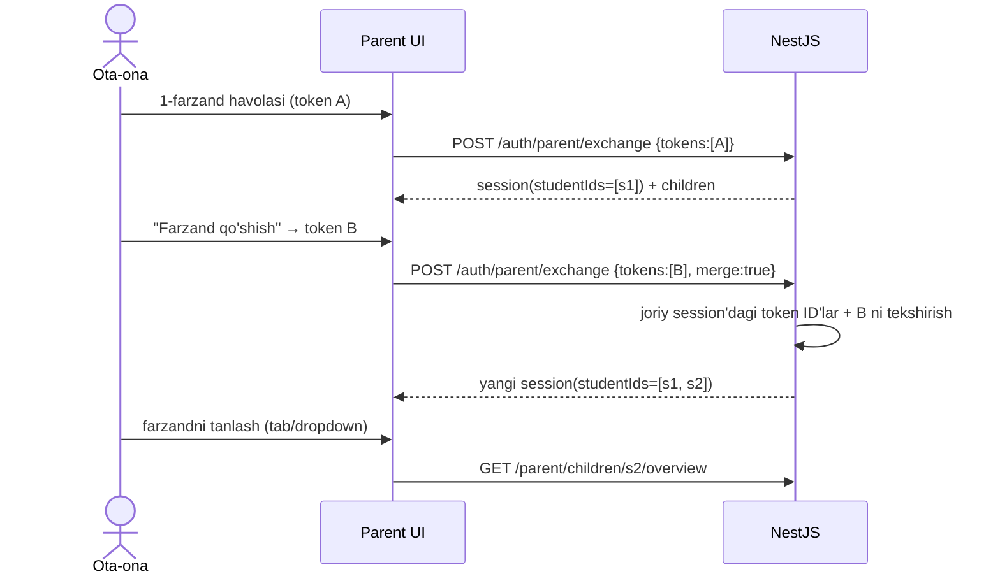
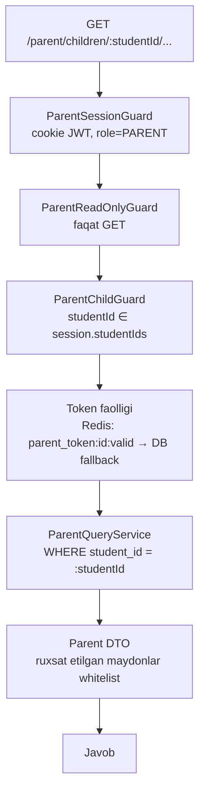

# 10. Ota-ona paneli

> **Qisqa mazmun:** Ota-ona token bilan kirgandan keyin nimalarni ko'radi, bir nechta farzand holati qanday ishlaydi, ma'lumotlar qanday filtrlanadi va read-only qanday kafolatlanadi. Auth tafsilotlari 02-auth'da.

---

## 1. Tamoyillar
1. **Akkaunt yo'q:** kirish faqat token orqali (02 §4.4–4.5).
2. **Faqat o'qish:** parent session faqat `GET` so'rovlar uchun ishlaydi.
3. **Faqat o'z farzandi:** har bir so'rovda `studentId ∈ session.studentIds` bo'lishi va token hali bekor qilinmagan bo'lishi tekshiriladi.
4. **Alohida API qatlami:** `/parent/*` controller'lari faqat ota-ona uchun "proyeksiya" qaytaradi. Student yoki mentor endpointlari qayta ishlatilmaydi, shu sabab ortiqcha ma'lumot (masalan chat, boshqa studentlar) sizib chiqmaydi.

## 2. Ota-ona ko'radigan ma'lumotlar

Tavsifdagi ro'yxat: progress, XP, coin, streak, davomat, natijalar, portfolio, bellashuv natijalari.

| Bo'lim | Ko'rsatiladi | Manba |
|---|---|---|
| **Umumiy** | Ism, avatar, guruh nomi, mentor ismi, yo'l nomi va progress %, XP (umumiy + bu hafta), coin balansi, joriy/eng uzun streak, liga va cohort'dagi o'rni, oxirgi faollik vaqti | `student_stats`, `topic_progress`, `league_memberships` |
| **Progress** | Xarita (read-only): mavzular holati, yakunlangan sana; bo'limlar bo'yicha % | `topic_progress`, `lesson_progress` |
| **Faollik** | Faollik kalendari (heatmap), haftalik o'qish vaqti (Taxmin) | `activity_days` |
| **Natijalar** | Takrorlash natijalari (mavzu, sana, %), haftalik quiz natijalari, 1-urinishdagi to'g'ri javob %, kunlik missiyalar bajarilishi | `review_logs`, `weekly_quiz_attempts`, `daily_missions` |
| **Davomat** | Meetinglar: sana, mavzu, status (Present/Late/Absent/Excused), umumiy davomat % | `meetings`, `meeting_attendance` |
| **Bellashuvlar** | O'yinlar soni, g'alaba/mag'lubiyat/durang, oxirgi 20 ta o'yin (raqib nomi, natija, sana) | `battles` |
| **Portfolio** | Statistika, ko'nikmalar, loyihalar + mentor bahosi, yutuqlar, sertifikatlar (yuklab olish) | 09 §2 |
| **XP/coin tarixi** | Oxirgi tranzaksiyalar (nimadan qancha olgan, nima sotib olgan) | `xp_transactions`, `coin_transactions`, `shop_orders` |

### Ko'rsatilmaydigan ma'lumotlar (Taxmin → S-58, S-60)
- Mentor ↔ student chati.
- Blog postlari va kommentlari.
- Kod maydoni snippetlari.
- Boshqa studentlarning shaxsiy ma'lumotlari. Liga jadvalida faqat farzandning o'rni ko'rinadi, boshqalarning ismlari ko'rsatilmaydi. Bellashuvda raqibning faqat ismi ko'rinadi.
- Savollarning to'g'ri javoblari.
- Ota-ona tokenlari ro'yxati.

## 3. Bir nechta farzand

**Qaror (S-15):** har farzand uchun alohida token beriladi va ota-ona panelida birlashtiriladi. Kirish ikki yo'l bilan bo'ladi: mentor yuborgan havola (token brauzerda `HttpOnly` cookie'da saqlanadi) yoki saytda kod kiritib farzand qo'shish (02 §5.1).

- Session JWT'da `tokenIds[]` va `studentIds[]` saqlanadi. Har bir so'rovda **shu so'ralgan studentga tegishli token** faolligi tekshiriladi (Redis kesh). Agar A bekor qilinsa, s1 ga kirish yopiladi, s2 esa ishlashda davom etadi.
- UI'da token bekor qilingan farzand kartochkasi "Kirish bekor qilingan, mentorga murojaat qiling" holatida ko'rinadi.
- Farzand qo'shish UI'si: kodni kiritish yoki havolani ochish (havola ochilganda joriy session bilan avtomatik birlashtiriladi).
- Qayta tashrif: `parent_tokens` cookie'si bor bo'lsa, ota-ona hech narsa kiritmasdan panelga tushadi (session avtomatik yangilanadi).

## 4. Ma'lumotlarni filtrlash

- **DTO whitelist:** javob maxsus `Parent*Dto` sinflari orqali qaytariladi (`class-transformer` `@Expose`). Yangi maydon entity'ga qo'shilsa, u ota-onaga avtomatik chiqib ketmaydi.
- **Rate limit:** session bo'yicha 120 so'rov/daqiqa.
- **Kesh:** `overview` 60 s keshlanadi (`parent:overview:{studentId}`).
- **Audit:** har bir exchange va (ixtiyoriy) birinchi kunlik kirish `parent_access_logs` ga yoziladi. Mentor token kartochkasida "oxirgi kirish" vaqtini ko'radi.

## 5. Ota-ona UI
- Mobil-first (ota-onalar asosan telefondan kiradi).
- Yuqorida farzand tanlagich, pastda tablar: Umumiy, Progress, Natijalar, Davomat, Portfolio.
- Hech qanday tahrirlash tugmasi yo'q.
- **Taxmin:** Ota-onaga bildirishnoma yuborilmaydi (akkaunt va kanal yo'q). Kelajakda Telegram bot orqali haftalik hisobot yuborilishi mumkin. → S-59

---

## Ochiq savollar (shu modul)

- **S-58** Ota-ona mentor bilan chatni ko'radimi yoki mentor bilan yozisha oladimi?
- **S-59** Ota-onaga haftalik hisobot yoki bildirishnoma yuborish kerakmi (Telegram/SMS)?
- **S-60** Ota-ona farzandining blog postlarini, liga jadvalidagi boshqa studentlarni ko'radimi?
