# 11. Ma'lumotlar bazasi

> **Qisqa mazmun:** 00–10 hujjatlar asosidagi to'liq PostgreSQL sxemasi (Prisma orqali). Har bir jadval: maydonlar, turlar, indekslar, bog'lanishlar. Modullar bo'yicha guruhlangan, har bir guruh uchun Mermaid ERD.

---

## 0. Umumiy konvensiyalar

| Qoida | Qaror |
|---|---|
| DBMS | PostgreSQL 16+ |
| ORM | Prisma (model nomlari `PascalCase`, jadvallar `@@map` orqali `snake_case` ko'plikda) |
| Primary key | `id uuid` (UUID v7: vaqt bo'yicha tartiblanadi va indeksga qulay). Katta, "faqat qo'shiladigan" jadvallar (`question_attempts`, `xp_transactions`, `messages` va h.k.) uchun `bigint identity` |
| Vaqt | `timestamptz`, UTC'da saqlanadi. "Kun" tushunchasi `date` turida, Asia/Tashkent bo'yicha hisoblanadi |
| Standart maydonlar | `created_at timestamptz default now()`, `updated_at timestamptz` (Prisma `@updatedAt`) |
| Soft delete | `deleted_at timestamptz NULL` faqat kerakli joylarda (users, groups, blog). Prisma'da middleware/extension orqali filtrlanadi |
| Enum'lar | PostgreSQL `enum` (Prisma `enum`) |
| JSON | `jsonb` (sozlamalar, javoblar, meta) |
| Pul/ball | `integer` (coin va XP butun son) |
| Nomlash | FK: `<entity>_id`; indeks: `idx_<table>_<cols>`; unique: `uq_<table>_<cols>` |

Belgilar: **PK** primary key, **FK** foreign key, **U** unique, **N** nullable, **IX** indeks.

---

## 1. Auth va foydalanuvchilar

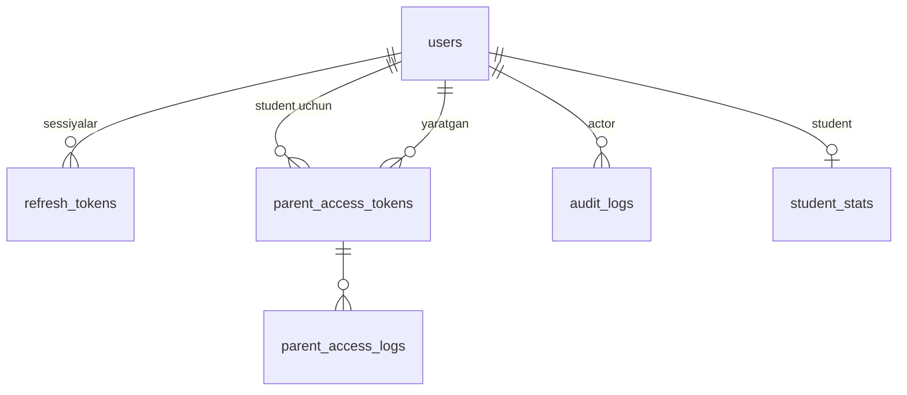

### `users`
Barcha akkauntli rollar bitta jadvalda (polimorfizm o'rniga `role` maydoni).

| Maydon | Tur | Izoh |
|---|---|---|
| id | uuid PK | |
| role | enum `Role` (`SUPER_ADMIN`,`ADMIN`,`MENTOR`,`STUDENT`) | |
| phone | varchar(16) U N | E.164. Staff uchun majburiy (CHECK) |
| student_code | varchar(16) U N | `ST-10245`. Student uchun majburiy (CHECK) |
| password_hash | text | Argon2id |
| must_change_password | boolean default false | |
| token_version | int default 0 | Barcha tokenlarni bekor qilish uchun |
| first_name | varchar(64) | |
| last_name | varchar(64) | |
| avatar_file_id | uuid FK→files N | |
| bio | varchar(500) N | Mentor profili uchun |
| status | enum `UserStatus` (`ACTIVE`,`INACTIVE`) | |
| blog_banned_until | timestamptz N | |
| last_login_at | timestamptz N | |
| last_seen_at | timestamptz N | |
| created_by_id | uuid FK→users N | |
| created_at, updated_at, deleted_at | timestamptz | |

- CHECK: `(role = 'STUDENT' AND student_code IS NOT NULL) OR (role <> 'STUDENT' AND phone IS NOT NULL)`.
- IX: `(role, status)`, `lower(first_name || ' ' || last_name)` (qidiruv uchun `pg_trgm` GIN).
- Sequence: `student_code_seq START 10001`.

### `refresh_tokens`
| Maydon | Tur | Izoh |
|---|---|---|
| id | uuid PK | |
| user_id | uuid FK→users | |
| token_hash | char(64) U | SHA-256 |
| family_id | uuid | Rotation zanjiri (reuse detection) |
| user_agent | varchar(256) N | |
| ip | inet N | |
| expires_at | timestamptz | |
| revoked_at | timestamptz N | |
| replaced_by_id | uuid FK→refresh_tokens N | |
| created_at | timestamptz | |

IX: `(user_id, revoked_at)`, `(family_id)`.

### `parent_access_tokens`
| Maydon | Tur | Izoh |
|---|---|---|
| id | uuid PK | |
| student_id | uuid FK→users | |
| token_hash | char(64) U | HMAC-SHA256(pepper, token) |
| token_prefix | varchar(8) | UI va log uchun |
| label | varchar(64) N | "Onasi", "Otasi" |
| created_by_id | uuid FK→users | Mentor/admin |
| expires_at | timestamptz N | |
| last_used_at | timestamptz N | |
| use_count | int default 0 | |
| revoked_at | timestamptz N | |
| revoked_by_id | uuid FK→users N | |
| created_at | timestamptz | |

IX: `(student_id) WHERE revoked_at IS NULL`.

### `parent_access_logs`
`id bigint PK`, `token_id FK`, `student_id FK`, `ip inet`, `user_agent`, `action varchar(32)` (`EXCHANGE`, `VIEW`), `created_at`. IX: `(token_id, created_at desc)`.

### `audit_logs`
| Maydon | Tur | Izoh |
|---|---|---|
| id | bigint PK | |
| actor_id | uuid FK→users N | |
| actor_role | enum Role N | |
| action | varchar(64) | `USER_CREATED`, `PASSWORD_RESET`, `PARENT_TOKEN_REVOKED`, `WALLET_ADJUSTED`, `SETTING_CHANGED`, ... |
| entity_type | varchar(32) | |
| entity_id | varchar(64) | |
| before | jsonb N | |
| after | jsonb N | |
| ip | inet N | |
| created_at | timestamptz | |

IX: `(entity_type, entity_id)`, `(actor_id, created_at desc)`, `(created_at)`.

---

## 2. Guruhlar

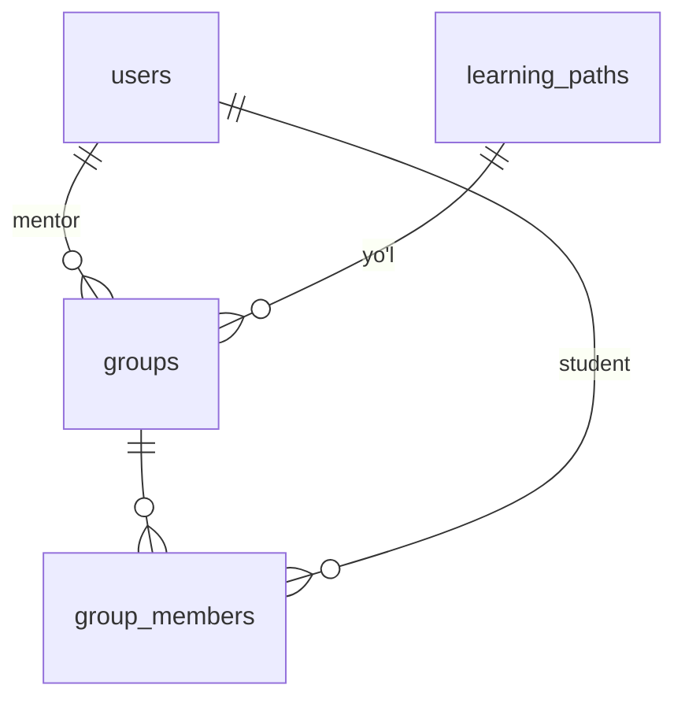

### `groups`
| Maydon | Tur | Izoh |
|---|---|---|
| id | uuid PK | |
| name | varchar(64) | |
| path_id | uuid FK→learning_paths | Guruh o'qiydigan yo'l (S-01) |
| mentor_id | uuid FK→users N | Bitta mentor (S-03) |
| status | enum `GroupStatus` (`ACTIVE`,`ARCHIVED`) | |
| starts_at | date N | |
| created_at, updated_at, deleted_at | | |

IX: `(mentor_id, status)`.

### `group_members`
| Maydon | Tur | Izoh |
|---|---|---|
| id | uuid PK | |
| group_id | uuid FK→groups | |
| student_id | uuid FK→users | |
| joined_at | timestamptz | |
| left_at | timestamptz N | |

- Partial U: `uq_group_members_active_student ON (student_id) WHERE left_at IS NULL`, ya'ni bitta faol guruh (S-02).
- IX: `(group_id) WHERE left_at IS NULL`.

---

## 3. Ilm yo'li va progress

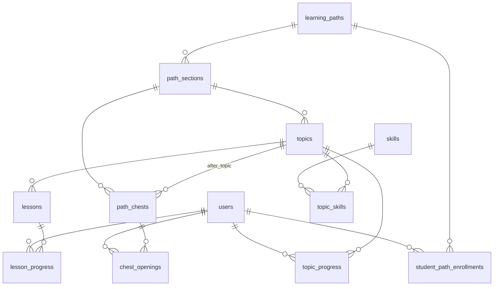

### `learning_paths`
`id uuid PK`, `title varchar(128)`, `slug varchar(128) U`, `description text N`, `cover_file_id FK N`, `status enum ContentStatus (DRAFT, PUBLISHED, ARCHIVED)`, `created_at`, `updated_at`.

### `path_sections`
`id uuid PK`, `path_id FK`, `order int`, `title varchar(128)`, `description text N`, `status ContentStatus`, timestamps. U: `(path_id, order)` DEFERRABLE (tartib almashtirish uchun).

### `topics`
| Maydon | Tur | Izoh |
|---|---|---|
| id | uuid PK | |
| section_id | uuid FK→path_sections | |
| order | int | Bo'lim ichida |
| title | varchar(128) | |
| description | text N | |
| icon | varchar(64) N | |
| status | ContentStatus | |
| created_at, updated_at | | |

U: `(section_id, order)` DEFERRABLE.

### `lessons`
| Maydon | Tur | Izoh |
|---|---|---|
| id | uuid PK | |
| topic_id | uuid FK→topics | |
| order | int | |
| title | varchar(128) | |
| content_md | text | Markdown |
| video_url | varchar(512) N | |
| est_minutes | smallint N | |
| status | ContentStatus | |
| created_at, updated_at | | |

U: `(topic_id, order)` DEFERRABLE.

### `path_chests`
`id uuid PK`, `section_id FK`, `after_topic_id FK→topics U`, `title varchar(64)`, `reward jsonb` (`{xp:{min,max}, coin:{min,max}}`), timestamps.

### `skills`, `topic_skills`
- `skills`: `id uuid PK`, `name varchar(64) U`, `icon N`.
- `topic_skills`: `topic_id FK`, `skill_id FK`, PK `(topic_id, skill_id)`.

### `student_path_enrollments`
`id uuid PK`, `student_id FK`, `path_id FK`, `started_at`, `completed_at N`. U: `(student_id, path_id)`.

### `topic_progress`
| Maydon | Tur | Izoh |
|---|---|---|
| student_id | uuid FK | PK qismi |
| topic_id | uuid FK | PK qismi |
| status | enum `TopicStatus` (`LOCKED`,`AVAILABLE`,`IN_PROGRESS`,`COMPLETED`) | `LOCKED` yozilmaydi (yozuv yo'q = locked) |
| lessons_completed | smallint | |
| first_try_correct | int | Mavzu savollari |
| first_try_total | int | |
| started_at | timestamptz N | |
| completed_at | timestamptz N | |
| updated_at | | |

PK `(student_id, topic_id)`. IX: `(student_id, status)`, `(topic_id, status)` (hisobotlar).

### `lesson_progress`
`student_id FK`, `lesson_id FK`, `status enum (IN_PROGRESS, COMPLETED)`, `started_at`, `completed_at N`. PK `(student_id, lesson_id)`. IX: `(student_id, completed_at)`.

### `chest_openings`
`id uuid PK`, `student_id FK`, `chest_id FK`, `xp int`, `coin int`, `opened_at`. U: `(student_id, chest_id)`.

---

## 4. Savollar bazasi

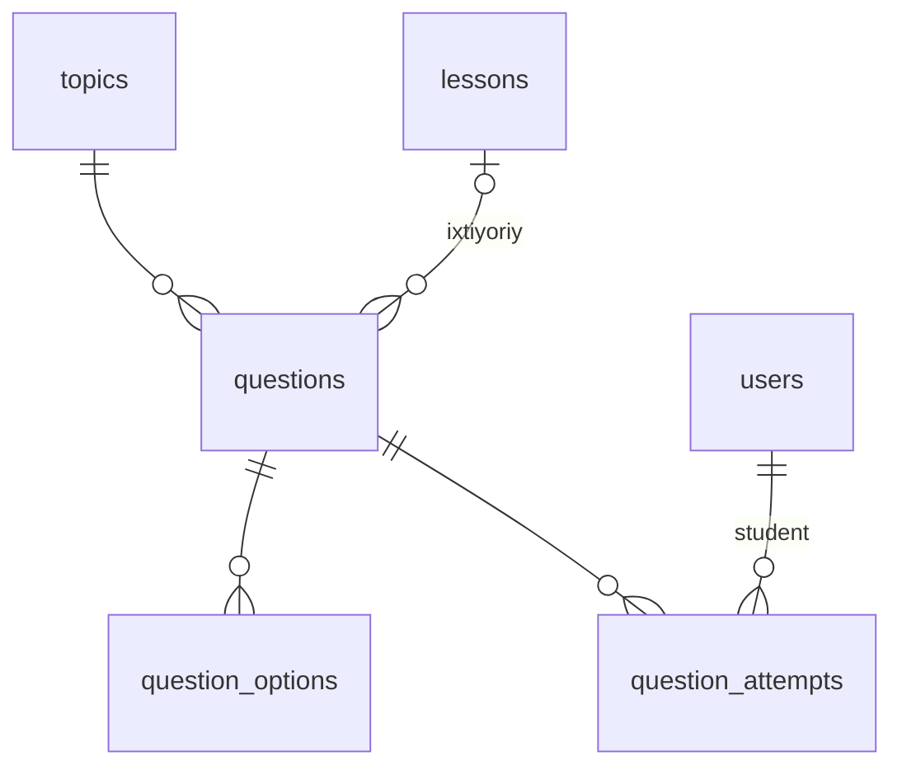

### `questions`
| Maydon | Tur | Izoh |
|---|---|---|
| id | uuid PK | |
| topic_id | uuid FK→topics | Majburiy |
| lesson_id | uuid FK→lessons N | |
| lesson_order | smallint N | Dars ichidagi tartib |
| type | enum `QuestionType` (`SINGLE_CHOICE`,`MULTIPLE_CHOICE`,`TRUE_FALSE`,`SHORT_TEXT`,`ORDERING`,`CODE_OUTPUT`) | S-34 |
| prompt_md | text | |
| explanation_md | text N | |
| difficulty | smallint (1–3) | |
| time_limit_sec | smallint N | |
| in_lesson, in_review, in_quiz, in_battle | boolean | |
| accepted_answers | jsonb N | `SHORT_TEXT` uchun |
| status | enum (`DRAFT`,`ACTIVE`,`ARCHIVED`) | |
| attempts_count | int default 0 | Denormalizatsiya |
| correct_count | int default 0 | |
| created_by_id | uuid FK→users | |
| created_at, updated_at | | |

IX: `(topic_id, status)`, `(lesson_id, lesson_order)`, `(topic_id) WHERE in_battle AND status='ACTIVE'`.

### `question_options`
`id uuid PK`, `question_id FK ON DELETE CASCADE`, `text_md text`, `is_correct boolean`, `order smallint`. IX: `(question_id, order)`.

### `question_attempts`
| Maydon | Tur | Izoh |
|---|---|---|
| id | bigint PK | |
| student_id | uuid FK | |
| question_id | uuid FK | |
| context | enum `AttemptContext` (`LESSON`,`REVIEW`,`QUIZ`,`BATTLE`) | |
| context_id | varchar(64) N | lesson/session/attempt/battle id |
| answer | jsonb | |
| is_correct | boolean | |
| is_first_attempt | boolean | Umrida birinchi marta |
| time_ms | int N | |
| created_at | timestamptz | |

- IX: `(student_id, question_id)`, `(student_id, created_at)`, `(question_id)`.
- Partial U: `(student_id, question_id) WHERE is_first_attempt`, bu birinchi urinish faqat bitta bo'lishini kafolatlaydi.
- Hajm katta bo'ladi, shuning uchun `created_at` bo'yicha oylik **partitioning** rejalashtiriladi (S-05 javobiga qarab).

---

## 5. Takrorlash, missiya, quiz

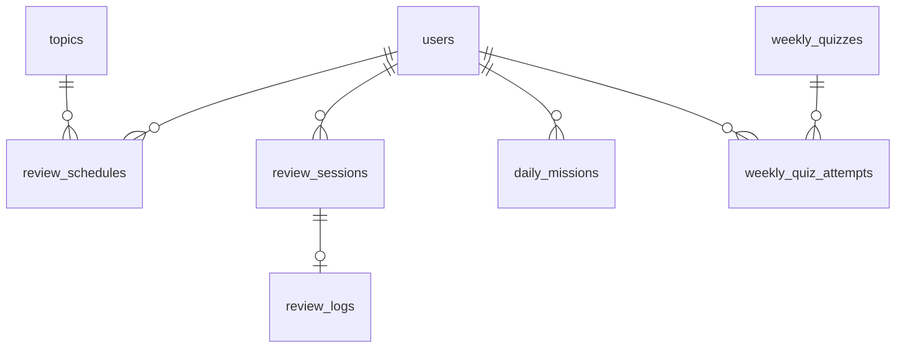

### `review_schedules`
| Maydon | Tur | Izoh |
|---|---|---|
| student_id | uuid FK | PK qismi |
| topic_id | uuid FK | PK qismi |
| ease_factor | numeric(4,2) default 2.50 | |
| interval_days | int | |
| repetitions | int | |
| lapses | int | |
| due_date | date | Asia/Tashkent kuni |
| last_reviewed_at | timestamptz N | |
| last_score | smallint N | % |

PK `(student_id, topic_id)`. IX: `(student_id, due_date)`.

### `review_sessions`
`id uuid PK`, `student_id FK`, `topic_id FK`, `question_ids uuid[]`, `status enum (ACTIVE, FINISHED, EXPIRED)`, `score_percent smallint N`, `started_at`, `finished_at N`. IX: `(student_id, status)`.

### `review_logs` (FSRS'ga o'tish uchun tarix)
`id bigint PK`, `student_id`, `topic_id`, `session_id FK U`, `grade smallint`, `score_percent`, `prev_interval`, `new_interval`, `prev_ef`, `new_ef`, `overdue_days`, `reviewed_at`. IX: `(student_id, reviewed_at)`.

### `daily_missions`
| Maydon | Tur | Izoh |
|---|---|---|
| id | uuid PK | |
| student_id | uuid FK | |
| date | date | |
| type | enum `MissionType` (`REVIEW`,`NEW_LESSON`,`WEEKLY_QUIZ`) | |
| target | smallint | |
| progress | smallint | |
| xp_reward | int | Yaratilgandagi sozlama qiymati |
| coin_reward | int | |
| completed_at | timestamptz N | |
| rewarded_at | timestamptz N | |

U: `(student_id, date, type)`.

### `weekly_quizzes`
`id uuid PK`, `week_start date U`, `opens_at`, `closes_at`, `config jsonb` (savollar soni, vaqt, taqsimot — yaratilgan paytdagi sozlama nusxasi).

### `weekly_quiz_attempts`
`id uuid PK`, `quiz_id FK`, `student_id FK`, `question_ids uuid[]`, `status enum (ACTIVE, FINISHED, EXPIRED)`, `correct_count smallint`, `total smallint`, `started_at`, `deadline_at`, `finished_at N`. U: `(quiz_id, student_id)`.

---

## 6. Gamifikatsiya

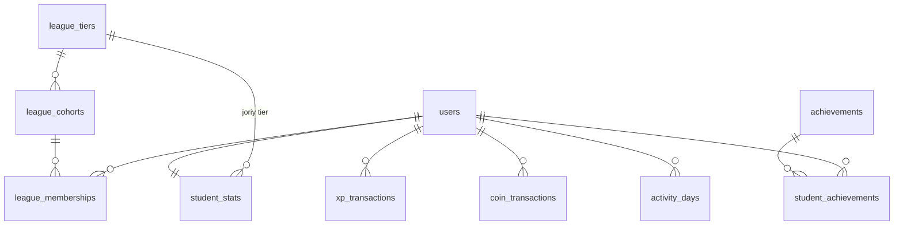

### `student_stats` (agregat, 1:1)
| Maydon | Tur | Izoh |
|---|---|---|
| student_id | uuid PK FK | |
| xp_total | int default 0 | |
| weekly_xp | int default 0 | |
| coin_balance | int default 0 CHECK ≥ 0 | |
| current_streak | int | |
| longest_streak | int | |
| last_active_date | date N | |
| league_tier_id | uuid FK→league_tiers | |
| topics_completed | int | |
| lessons_completed | int | |
| battles_won, battles_lost, battles_draw | int | |
| updated_at | | |

IX: `(xp_total desc)`.

### `xp_transactions`
| Maydon | Tur | Izoh |
|---|---|---|
| id | bigint PK | |
| student_id | uuid FK | |
| amount | int | ±. Faqat `ADJUSTMENT` manfiy bo'ladi |
| source_type | enum `RewardSource` | 04 §1.1 dagi ro'yxat |
| source_id | varchar(64) N | |
| idempotency_key | varchar(160) U | |
| week_start | date | Liga uchun |
| meta | jsonb N | `{settingKey, reason, actorId}` |
| created_at | timestamptz | |

IX: `(student_id, created_at)`, `(student_id, week_start)`.

### `coin_transactions`
`xp_transactions` bilan bir xil, qo'shimcha: `balance_after int`. `source_type` qo'shimcha qiymatlari: `SHOP_PURCHASE`, `SHOP_REFUND`.

### `activity_days`
`student_id FK`, `date date`, `xp int`, `actions_count int`, `is_streak_day boolean`. PK `(student_id, date)`.

### `achievements`
`id uuid PK`, `code varchar(64) U`, `title`, `description`, `icon_file_id N`, `rule_type enum AchievementRule`, `threshold int`, `xp_reward int`, `coin_reward int`, `is_active boolean`, timestamps.

### `student_achievements`
`student_id FK`, `achievement_id FK`, `unlocked_at`. PK `(student_id, achievement_id)`.

### `league_tiers`
`id uuid PK`, `name varchar(32)`, `order smallint U`, `promote_count smallint`, `demote_count smallint`, `rewards jsonb` (o'rin → xp/coin), `icon N`.

### `league_cohorts`
`id uuid PK`, `tier_id FK`, `week_start date`, `size smallint`, `status enum (OPEN, CLOSED)`. IX: `(week_start, tier_id, status)`.

### `league_memberships`
| Maydon | Tur | Izoh |
|---|---|---|
| id | uuid PK | |
| cohort_id | uuid FK | |
| student_id | uuid FK | |
| week_start | date | Denormalizatsiya |
| weekly_xp | int | |
| last_xp_at | timestamptz N | Tie-break |
| final_rank | smallint N | |
| outcome | enum (`PROMOTED`,`STAYED`,`DEMOTED`) N | |

U: `(student_id, week_start)`. IX: `(cohort_id, weekly_xp desc, last_xp_at)`.

### `reward_settings` va `setting_changes`
- `reward_settings`: `key varchar(96) PK`, `value jsonb`, `group varchar(32)`, `description text`, `updated_by_id FK N`, `updated_at`.
- `system_settings`: shu tuzilmada, faqat super admin uchun.
- `setting_changes`: `id bigint PK`, `key`, `old_value jsonb`, `new_value jsonb`, `changed_by_id`, `created_at`.

---

## 7. Bildirishnomalar

### `notifications`
| Maydon | Tur | Izoh |
|---|---|---|
| id | bigint PK | |
| user_id | uuid FK | |
| type | varchar(48) | `LESSON_UNLOCKED`, `REVIEW_DUE`, `CHAT_MESSAGE`, `MEETING_REMINDER`, `LEAGUE_RESULT`, `BATTLE_INVITE`, `ORDER_STATUS`, `BLOG_LIKE`, ... |
| title | varchar(128) | |
| body | varchar(500) N | |
| data | jsonb N | Deep link parametrlari |
| group_key | varchar(96) N | Guruhlash ("5 kishi yoqtirdi") |
| read_at | timestamptz N | |
| created_at | | |

IX: `(user_id, created_at desc)`, `(user_id) WHERE read_at IS NULL`. Eski yozuvlar 90 kundan keyin tozalanadi (Taxmin).

---

## 8. Bellashuv

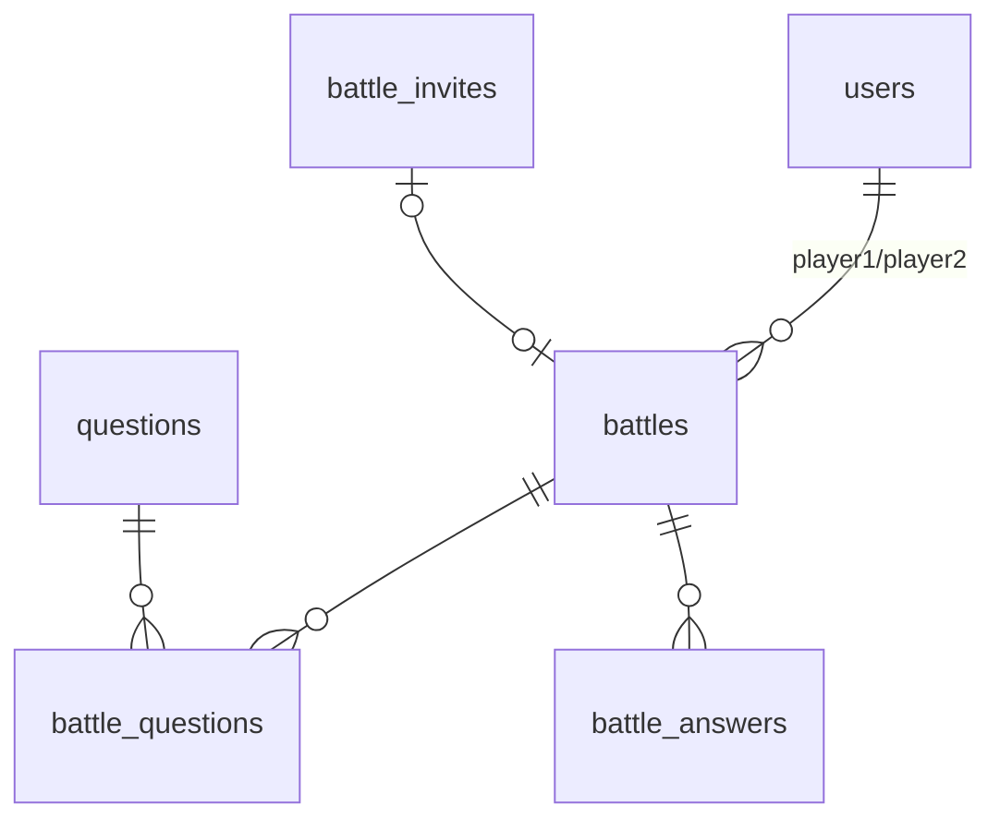

### `battles`
| Maydon | Tur | Izoh |
|---|---|---|
| id | uuid PK | |
| mode | enum `BattleMode` (`RANDOM`,`FRIEND`,`BOT`) | |
| status | enum `BattleStatus` (`MATCHED`,`IN_PROGRESS`,`FINISHED`,`CANCELLED`,`ABANDONED`) | |
| player1_id | uuid FK | |
| player2_id | uuid FK N | Bot bo'lsa NULL |
| bot_accuracy | numeric(3,2) N | |
| score1, score2 | int | |
| winner_id | uuid FK N | NULL: durang yoki bot yutdi |
| result_reason | enum (`NORMAL`,`FORFEIT`) N | |
| started_at, finished_at | timestamptz N | |
| created_at | | |

IX: `(player1_id, created_at desc)`, `(player2_id, created_at desc)`.

### `battle_questions`
`battle_id FK`, `index smallint`, `question_id FK`. PK `(battle_id, index)`.

### `battle_answers`
`id bigint PK`, `battle_id FK`, `index smallint`, `player_id uuid N` (bot uchun NULL + `is_bot`), `is_bot boolean`, `answer jsonb N`, `is_correct boolean`, `time_ms int`, `points int`. U: `(battle_id, index, player_id, is_bot)`.

### `battle_invites`
`id uuid PK`, `code varchar(8) U`, `inviter_id FK`, `battle_id FK N`, `expires_at`, `status enum (OPEN, ACCEPTED, EXPIRED, CANCELLED)`, `created_at`.

---

## 9. Kod maydoni

### `code_snippets`
`id uuid PK`, `student_id FK`, `title varchar(128)`, `language enum (WEB, PYTHON)`, `files jsonb`, `created_at`, `updated_at`. IX: `(student_id, updated_at desc)`.

---

## 10. Mentor: chat, meeting, materiallar

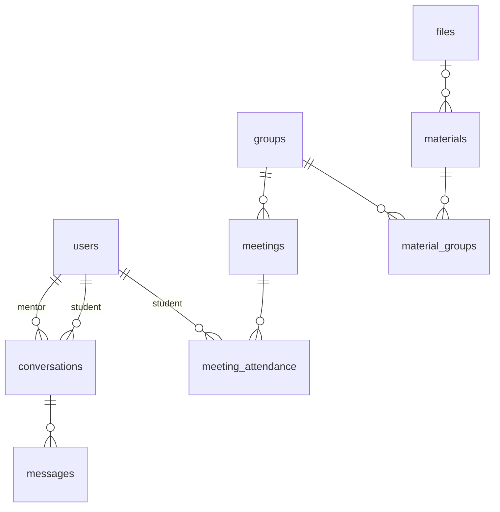

### `conversations`
`id uuid PK`, `mentor_id FK`, `student_id FK`, `is_archived boolean`, `last_message_at N`, `mentor_last_read_id bigint N`, `student_last_read_id bigint N`, `created_at`. U: `(mentor_id, student_id)`. IX: `(mentor_id, last_message_at desc)`, `(student_id, last_message_at desc)`.

### `messages`
| Maydon | Tur | Izoh |
|---|---|---|
| id | bigint PK | |
| conversation_id | uuid FK | |
| sender_id | uuid FK | |
| client_id | uuid | Idempotentlik |
| body | text N | ≤ 4000 |
| attachment_file_id | uuid FK→files N | |
| edited_at | timestamptz N | |
| deleted_at | timestamptz N | |
| created_at | | |

U: `(sender_id, client_id)`. IX: `(conversation_id, id desc)`.

### `meetings`
| Maydon | Tur | Izoh |
|---|---|---|
| id | uuid PK | |
| group_id | uuid FK N | Guruh meetingi |
| student_id | uuid FK N | 1:1 meeting (S-46) |
| mentor_id | uuid FK | |
| title | varchar(128) | |
| description | text N | |
| starts_at | timestamptz | |
| duration_min | smallint | |
| provider | enum (`LIVEKIT`,`JITSI`) | |
| room_name | varchar(128) U | |
| status | enum (`SCHEDULED`,`LIVE`,`ENDED`,`CANCELLED`) | |
| started_at, ended_at | timestamptz N | |
| created_at, updated_at | | |

CHECK: `group_id IS NOT NULL OR student_id IS NOT NULL`. IX: `(group_id, starts_at)`, `(mentor_id, starts_at)`.

### `meeting_attendance`
| Maydon | Tur | Izoh |
|---|---|---|
| meeting_id | uuid FK | PK qismi |
| student_id | uuid FK | PK qismi |
| status | enum `AttendanceStatus` (`PRESENT`,`LATE`,`ABSENT`,`EXCUSED`) N | NULL = mentor hali belgilamagan |
| auto_status | enum AttendanceStatus N | Webhook asosida |
| first_joined_at | timestamptz N | |
| total_seconds | int default 0 | |
| note | varchar(256) N | |
| marked_by_id | uuid FK N | |
| marked_at | timestamptz N | |

PK `(meeting_id, student_id)`. IX: `(student_id)`.

### `meeting_participant_events`
`id bigint PK`, `meeting_id`, `user_id`, `event enum (JOINED, LEFT)`, `at timestamptz`, `raw jsonb`. Webhook'lardan keladi, davomat shundan hisoblanadi.

### `materials` va `material_groups`
- `materials`: `id uuid PK`, `mentor_id FK`, `title`, `description N`, `type enum (FILE, LINK)`, `file_id FK N`, `url N`, timestamps, `deleted_at`.
- `material_groups`: `material_id FK`, `group_id FK`, PK `(material_id, group_id)`.

---

## 11. Fayllar

### `files`
| Maydon | Tur | Izoh |
|---|---|---|
| id | uuid PK | |
| owner_id | uuid FK N | |
| bucket | varchar(32) | `public`/`private` |
| key | varchar(256) U | Object storage kaliti |
| mime | varchar(96) | |
| size_bytes | int | |
| purpose | enum (`AVATAR`,`BLOG_IMAGE`,`CHAT_ATTACHMENT`,`MATERIAL`,`PROJECT_IMAGE`,`CERTIFICATE`,`PRODUCT_IMAGE`,`CONTENT`,`EXPORT`) | |
| status | enum (`PENDING`,`READY`) | Pre-signed upload tasdiqlanguncha `PENDING` |
| created_at | | |

IX: `(owner_id, purpose)`. Tungi job 24 soatdan eski `PENDING` fayllarni tozalaydi.

---

## 12. Portfolio

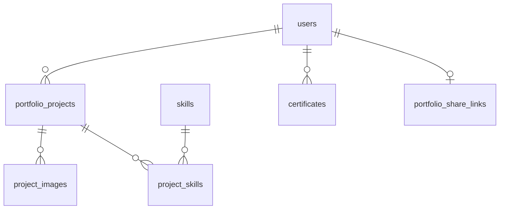

### `portfolio_projects`
| Maydon | Tur | Izoh |
|---|---|---|
| id | uuid PK | |
| student_id | uuid FK | |
| title | varchar(128) | |
| description | text | |
| repo_url, demo_url | varchar(512) N | |
| status | enum (`DRAFT`,`SUBMITTED`,`CHANGES_REQUESTED`,`REVIEWED`) | |
| score | smallint N | 1–100 (S-53) |
| mentor_feedback | text N | |
| reviewed_by_id | uuid FK N | |
| submitted_at, reviewed_at | timestamptz N | |
| show_in_portfolio | boolean default true | |
| created_at, updated_at | | |

IX: `(student_id, status)`, `(status, submitted_at)`.

### `project_images`, `project_skills`
- `project_images`: `project_id FK`, `file_id FK`, `order smallint`, PK `(project_id, file_id)`.
- `project_skills`: `project_id FK`, `skill_id FK`, PK.

### `certificates`
`id uuid PK`, `student_id FK`, `serial varchar(32) U`, `path_id FK N`, `section_id FK N`, `title varchar(160)`, `issued_at`, `issued_by_id FK N` (NULL = avtomatik), `pdf_file_id FK N`, `revoked_at N`, `revoke_reason N`. U: `(student_id, section_id)`, `(student_id, path_id)`.

### `portfolio_share_links`
`student_id uuid PK FK`, `slug varchar(16) U`, `is_active boolean`, `created_at`, `updated_at`.

---

## 13. Blog

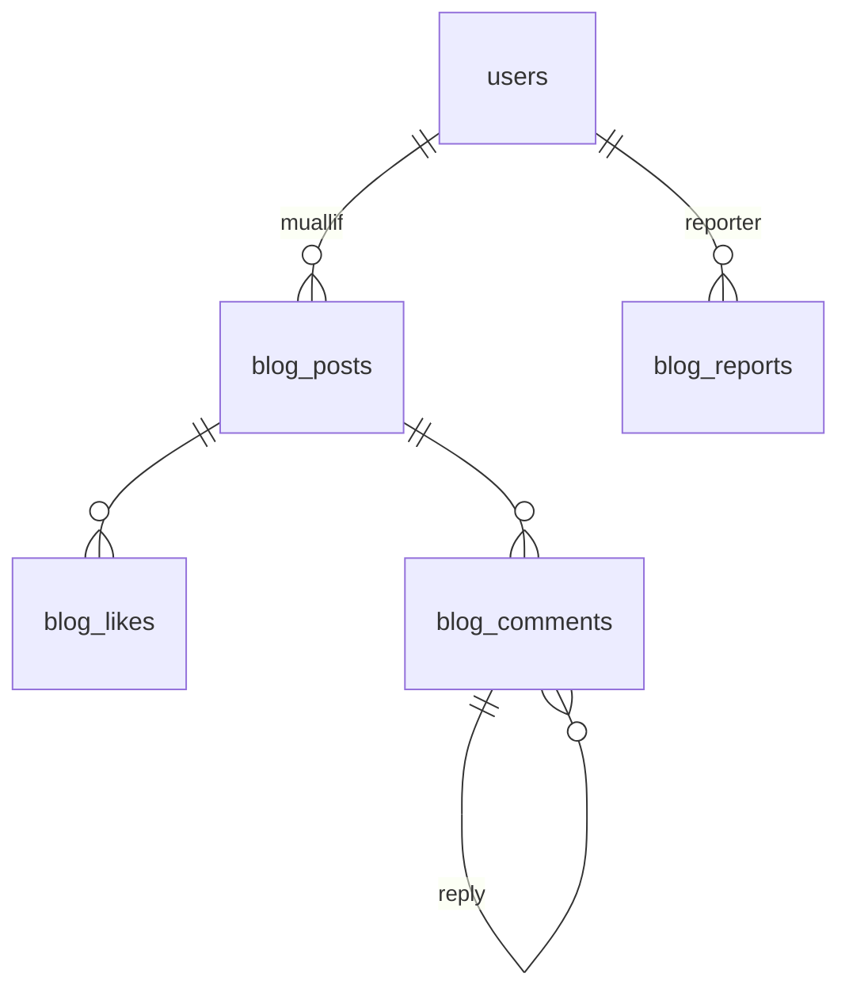

### `blog_posts`
| Maydon | Tur | Izoh |
|---|---|---|
| id | uuid PK | |
| author_id | uuid FK | |
| title | varchar(120) | |
| body | varchar(2000) | |
| image_file_id | uuid FK N | |
| status | enum `BlogStatus` (`PUBLISHED`,`PENDING_REVIEW`,`HIDDEN`,`DELETED`) | |
| like_count | int default 0 | |
| comment_count | int default 0 | |
| report_count | int default 0 | |
| moderated_by_id | uuid FK N | |
| moderated_at | timestamptz N | |
| created_at, updated_at | | |

IX: `(status, created_at desc)`, `(author_id, created_at desc)`.

### `blog_likes`
`post_id FK`, `user_id FK`, `created_at`. PK `(post_id, user_id)`.

### `blog_comments`
`id uuid PK`, `post_id FK`, `author_id FK`, `parent_id FK→blog_comments N`, `body varchar(500)`, `status BlogStatus`, `created_at`. IX: `(post_id, created_at)`.

### `blog_reports`
`id uuid PK`, `target_type enum (POST, COMMENT)`, `target_id uuid`, `reporter_id FK`, `reason enum (SPAM, ABUSE, INAPPROPRIATE, OTHER)`, `details varchar(500) N`, `status enum (OPEN, RESOLVED, DISMISSED)`, `resolved_by_id N`, `resolved_at N`, `created_at`. U: `(target_type, target_id, reporter_id)`. IX: `(status, created_at)`.

---

## 14. Shop

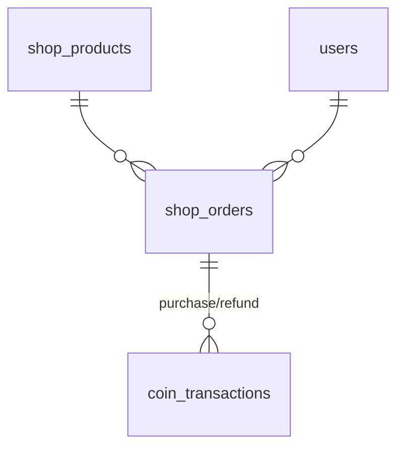

### `shop_products`
| Maydon | Tur | Izoh |
|---|---|---|
| id | uuid PK | |
| title | varchar(128) | |
| description | text N | |
| image_file_id | uuid FK N | |
| type | enum (`PHYSICAL`,`DIGITAL`) | S-56 |
| price_coin | int CHECK > 0 | |
| stock | int N | NULL = cheksiz |
| per_student_limit | int N | |
| auto_deliver | boolean | Raqamli mahsulot uchun |
| is_active | boolean | |
| created_at, updated_at | | |

### `shop_orders`
| Maydon | Tur | Izoh |
|---|---|---|
| id | uuid PK | |
| student_id | uuid FK | |
| product_id | uuid FK | |
| quantity | smallint | |
| unit_price | int | Xarid paytidagi narx |
| total_coin | int | |
| status | enum `OrderStatus` (`PENDING`,`APPROVED`,`DELIVERED`,`CANCELLED`) | |
| idempotency_key | varchar(64) U | |
| note | varchar(500) N | Admin izohi |
| handled_by_id | uuid FK N | |
| created_at, updated_at | | |

IX: `(student_id, created_at desc)`, `(status, created_at)`.

---

## 15. Umumiy (yuqori darajadagi) ERD

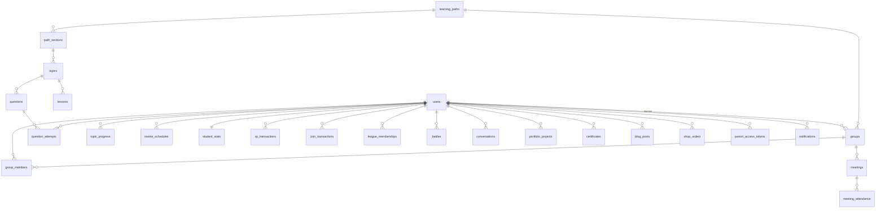

## 16. Redis kalitlari (bazadan tashqari holat)

| Kalit | Tur | TTL | Maqsad |
|---|---|---|---|
| `settings:all` | hash | — (invalidatsiya) | Sozlamalar keshi |
| `user:{id}:ver` | string | 1 soat | `token_version` |
| `parent_token:{id}:valid` | string | 5 daqiqa | Token faolligi |
| `mentor:{id}:studentIds` | set | 60 s | Scope keshi |
| `path:{studentId}` | string (json) | 10 daqiqa | Xarita keshi |
| `league:{cohortId}` | zset | hafta | Real-time liga jadvali |
| `battle:queue` | zset | — | Matchmaking |
| `battle:{id}` | hash | 1 soat | Bellashuv holati |
| `battle:active:{studentId}` | string | 1 soat | Bitta faol o'yin |
| `presence:{userId}` | string | 60 s | Onlayn holat |
| `rl:*` | string | — | Rate limit hisoblagichlari |
| `bull:*` | — | — | BullMQ navbatlari |

---

## Ochiq savollar (shu modul)

- **S-05** Masshtab (`question_attempts`, `xp_transactions` partitioning qachon kerak bo'ladi)?
- **S-46** 1:1 meeting kerakmi (`meetings.student_id`)?
- **S-61** Ma'lumotlar qayerda saqlanadi (hosting, O'zbekiston qonunchiligi bo'yicha shaxsga doir ma'lumotlarni lokalizatsiya qilish talabi)?
- **S-62** Bildirishnomalar va audit loglar qancha muddat saqlanadi?
