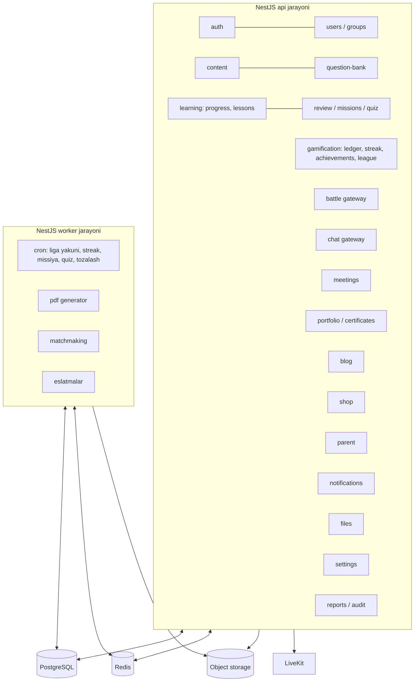
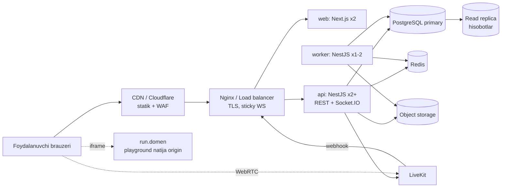

# 13. Arxitektura va stack

> **Qisqa mazmun:** Tavsiya etilgan texnologiyalar, backend modulli monolit arxitekturasi, frontend va backend papka tuzilmasi, deploy sxemasi, background job'lar, keshlash, fayl saqlash, xavfsizlik va kuzatuv (observability).

---

## 1. Stack

| Qatlam | Texnologiya | Izoh |
|---|---|---|
| Frontend | **Next.js** (App Router), TypeScript, React | SSR faqat public sahifalar uchun (portfolio, verify). Ichki panellar asosan CSR |
| UI | Tailwind CSS + o'z komponentlar kutubxonasi (Radix primitives) | "Dizayn o'zimizniki" |
| Server state | TanStack Query | Keshlash, optimistic update |
| Client state | Zustand | Yuqori panel, socket holati |
| Forma | React Hook Form + Zod | Zod sxemalari `packages/shared` da, backend bilan umumiy |
| Grafiklar | Recharts yoki ECharts | Portfolio, hisobotlar |
| Editor | CodeMirror 6, Pyodide (07) | |
| Meeting UI | `@livekit/components-react` (S-45) | |
| Backend | **NestJS**, TypeScript | Modulli monolit |
| ORM | **Prisma** | Murakkab hisobotlar uchun `$queryRaw`/view'lar |
| DB | **PostgreSQL 16** | `pg_trgm`, partial index, partitioning |
| Kesh / navbat | **Redis 7** | Kesh, rate limit, Socket.IO adapter, BullMQ, leaderboard |
| Background jobs | **BullMQ** | Cron va delayed job'lar |
| Real-time | **Socket.IO** + `@socket.io/redis-adapter` | Chat, bellashuv, bildirishnoma |
| Auth | JWT (`@nestjs/jwt`), Argon2id | 02 |
| Fayl saqlash | S3-compatible object storage (dev: MinIO; prod: istalgan S3-compatible provayder, env orqali) | S-61 |
| PDF | Playwright (HTML → PDF) worker'da | Sertifikat, portfolio |
| Meeting | LiveKit (Cloud → self-host) | 08 |
| Monorepo | pnpm workspaces + Turborepo | **Taxmin** → S-64 |
| Test | Vitest/Jest, Supertest, Playwright (e2e), Testcontainers (Postgres/Redis) | |
| CI/CD | GitHub Actions (Taxmin) | |
| Konteyner | Docker, docker compose (dev, kichik prod) | Kattalashganda Kubernetes |

## 2. Backend arxitekturasi: modulli monolit

Mikroservislar emas, **modulli monolit**: bitta NestJS kod bazasi, aniq chegaralangan modullar, ikki xil ishga tushirish rejimi (`api` va `worker`).

Sabablari: jamoa kichik, tranzaksiyalar modullararo bo'ladi (masalan ledger + progress), deploy sodda bo'ladi. Keyin kerak bo'lsa, `battle` yoki `code-runner` alohida servisga chiqariladi.



### Modullararo aloqa qoidalari
- Har bir modul faqat boshqa modulning **public service**'ini chaqiradi, uning jadvallariga to'g'ridan-to'g'ri kirmaydi.
- Yon effektlar uchun **domen hodisalari** ishlatiladi (`@nestjs/event-emitter`; ishonchlilik kerak bo'lgan joylarda **outbox** jadvali + BullMQ). Misol: `lesson.completed` → gamification (XP), review (rejalashtirish), missions (progress), achievements, notifications.
- Mukofot har doim faqat `GamificationModule.RewardService` orqali beriladi (04).

## 3. Papka tuzilmasi

```
ico-it-academy/
├── apps/
│   ├── web/                          # Next.js
│   │   ├── src/
│   │   │   ├── app/
│   │   │   │   ├── (public)/         # login, parent, p/[slug], verify/[serial]
│   │   │   │   ├── (student)/        # path, review, today, league, battle, playground,
│   │   │   │   │                     # portfolio, blog, mentor, shop, profile, notifications
│   │   │   │   ├── (mentor)/mentor/  # dashboard, groups, students, chat, meetings, materials, reviews
│   │   │   │   ├── (admin)/admin/    # users, groups, paths, questions, settings, shop, blog, reports
│   │   │   │   └── (parent)/parent/
│   │   │   ├── features/             # domen bo'yicha: path, lesson, battle, chat, ...
│   │   │   │   └── battle/{components,hooks,api,store}
│   │   │   ├── components/ui/        # dizayn tizimi
│   │   │   ├── lib/                  # api client, socket, auth, utils
│   │   │   └── styles/
│   │   └── public/pyodide/           # (ixtiyoriy) Pyodide fayllari
│   ├── api/                          # NestJS
│   │   ├── src/
│   │   │   ├── main.ts               # api rejimi
│   │   │   ├── worker.ts             # worker rejimi
│   │   │   ├── common/               # guards (jwt, roles, scope, parent-readonly), decorators,
│   │   │   │                         # filters, interceptors, pipes, pagination
│   │   │   ├── infra/                # prisma, redis, queue, storage, mailer-yo'q, livekit
│   │   │   └── modules/
│   │   │       ├── auth/
│   │   │       ├── users/
│   │   │       ├── groups/
│   │   │       ├── content/          # paths, sections, topics, lessons, chests, skills
│   │   │       ├── question-bank/
│   │   │       ├── learning/         # progress, unlock qoidalari
│   │   │       ├── review/           # scheduler (SM-2), sessions, missions, weekly-quiz
│   │   │       ├── gamification/     # ledger, streak, achievements, league, settings
│   │   │       ├── battle/
│   │   │       ├── playground/
│   │   │       ├── chat/
│   │   │       ├── meetings/
│   │   │       ├── materials/
│   │   │       ├── portfolio/
│   │   │       ├── blog/
│   │   │       ├── shop/
│   │   │       ├── parent/
│   │   │       ├── notifications/
│   │   │       ├── files/
│   │   │       └── reports/
│   │   │           # har bir modul: *.module.ts, controllers/, services/, dto/, events/, *.spec.ts
│   │   ├── prisma/
│   │   │   ├── schema.prisma
│   │   │   ├── migrations/
│   │   │   └── seed.ts               # super admin, sozlamalar, liga tierlari
│   │   └── test/                     # e2e
├── packages/
│   ├── shared/                       # Zod sxemalar, enum'lar, API tiplari, socket event tiplari
│   ├── ui/                           # (ixtiyoriy) umumiy UI
│   └── config/                       # eslint, tsconfig
├── infra/
│   ├── docker/                       # Dockerfile'lar
│   ├── compose/                      # docker-compose.dev.yml, prod.yml
│   └── nginx/
├── docs/
├── CLAUDE.md
└── turbo.json
```

## 4. Deploy sxemasi



- **Muhitlar:** `dev` (docker compose), `staging`, `production`.
- **Socket.IO:** load balancer'da sticky session (yoki faqat WebSocket transport) va Redis adapter.
- **Worker:** cron job'lar bitta nusxada ishlaydi (BullMQ repeatable jobs bunga o'zi kafolat beradi).
- **Migratsiyalar:** CI'da `prisma migrate deploy` deploy'dan oldin alohida qadam sifatida bajariladi.
- **Zaxira nusxa:** PostgreSQL kunlik to'liq backup + WAL arxivi (PITR), object storage versioning. Tiklashni oyda bir marta sinab ko'rish.
- **Hosting (S-61, egasi qarori):** egasining ma'lumotiga ko'ra, 2026-yil martidagi o'zgartirishdan keyin majburiy lokalizatsiya faqat biometrik, genetik va telekom ma'lumotlariga tegishli. Boshqa ma'lumotlar ma'lum shartlar bilan chet elda saqlanishi mumkin (huquqshunos tasdiqlaydi). Shu sababli arxitektura **hosting'ga bog'lanmaydi**: hamma narsa Docker konteynerlarida ishlaydi, barcha tashqi manzillar (DB, Redis, S3 endpoint, LiveKit) env orqali sozlanadi va provayderga xos SDK ishlatilmaydi (S3-compatible API). Hosting keyin tanlanadi.

## 5. Background job'lar (BullMQ)

| Job | Jadval | Vazifa |
|---|---|---|
| `league.close-week` | Dushanba 00:00 | Liga yakuni (04 §5.2) |
| `streak.reset` | Har kuni 00:05 | Uzilgan streak'larni 0 qilish |
| `streak.reminder` | Har kuni 20:00 | Streak eslatmasi |
| `missions.generate` | Har kuni 00:05 (yoki lazy) | Kunlik missiyalar |
| `quiz.open-weekly` | Dushanba 00:00 | Haftalik quiz yaratish |
| `review.due-notify` | Har kuni 09:00 | "Takrorlash vaqti" bildirishnomasi |
| `meeting.reminder` | Delayed | 1 kun / 15 daqiqa oldin |
| `pdf.certificate`, `pdf.portfolio` | Hodisa | PDF generatsiya |
| `ledger.reconcile` | Har kuni 03:00 | Agregat va ledger'ni solishtirish |
| `files.cleanup` | Har kuni | Eski `PENDING` fayllarni tozalash |
| `notifications.cleanup` | Haftalik | 90 kundan eski bildirishnomalar (S-62) |
| `battle.matchmaking` | Har 1 s | Juftlash |

## 6. Keshlash

| Nima | Qayerda | Invalidatsiya |
|---|---|---|
| Sozlamalar | Redis + in-memory (5 s) | Redis pub/sub `settings:changed` |
| Kontent daraxti (yo'l) | Redis, `content:path:{id}:v{version}` | Kontent o'zgarganda versiya oshadi |
| Student xaritasi | Redis `path:{studentId}` 10 daqiqa | Progress hodisasi |
| Mentor scope | Redis set 60 s | Guruh a'zoligi o'zgarganda |
| Token versiya / parent token | Redis | Parol tiklash, revoke |
| Liga jadvali | Redis ZSET | Real-time, hafta yakunida DB'ga yoziladi |
| Public portfolio | CDN/Next.js ISR 5 daqiqa | Share o'chirilganda purge |
| Statik fayllar, Pyodide | CDN, immutable | Fayl nomida hash |

## 7. Fayl saqlash

- **Pre-signed URL** oqimi: `POST /files/upload-url` → klient to'g'ridan-to'g'ri S3'ga `PUT` qiladi → `POST /files/:id/confirm` (hajm va MIME server tomonida qayta tekshiriladi).
- Bucket'lar:
  - `public` — blog rasmlari, avatarlar, mahsulot rasmlari, CDN orqali beriladi.
  - `private` — materiallar, chat fayllari, sertifikat PDF'lari, eksportlar. Faqat qisqa muddatli (5 daqiqa) signed URL bilan, ruxsat tekshirilgandan keyin.
- Rasm ishlov berish: worker'da `sharp` bilan resize, WebP formatiga o'tkazish va EXIF'ni o'chirish.
- Limitlar (sozlama): avatar 2 MB, blog 5 MB, chat 10 MB, material 50 MB.
- **Taxmin:** Antivirus skanerlash (ClamAV) material va chat fayllari uchun kerak bo'ladi. → S-63

## 8. Xavfsizlik

| Soha | Choralar |
|---|---|
| Auth | Argon2id, JWT qisqa umrli, refresh rotation + reuse detection, `token_version`, login rate limit (02) |
| RBAC | Global `JwtAuthGuard` (`@Public()` istisno bilan), `RolesGuard`, `ScopeGuard`, `ParentReadOnlyGuard`. **Default — taqiqlangan**: `@Roles` ko'rsatilmagan endpoint CI'dagi test orqali aniqlanadi |
| IDOR | Har bir resurs scope bilan olinadi, scope'dan tashqari bo'lsa 404. E2E testlarda har bir rol × endpoint matritsasi tekshiriladi |
| Input | DTO validatsiya (whitelist, `forbidNonWhitelisted`), Prisma (SQL injection'dan himoya) |
| XSS | Markdown → HTML sanitizatsiya (`rehype-sanitize`), blog matni oddiy matn, CSP header |
| Playground | Alohida origin, sandbox iframe, `allow-same-origin` yo'q (07) |
| CSRF | Cookie `SameSite=Strict`, cookie bilan ishlaydigan endpointlarda custom header |
| Header'lar | `helmet`: HSTS, `X-Content-Type-Options`, `Referrer-Policy: no-referrer` (parent sahifa), `frame-ancestors` |
| Rate limit | `@nestjs/throttler` + Redis: auth, parent exchange, answers, chat, blog, shop |
| Sirlar | Env/secret manager, `.env` repoda saqlanmaydi, JWT kalitlari va parent pepper rotatsiyasi |
| Ma'lumot | TLS hamma joyda, DB backup shifrlangan, loglarda token/parol yozilmaydi (pino redact) |
| Audit | `audit_logs` (01 §4) |
| Webhook | LiveKit webhook imzosini tekshirish |
| Bog'liqliklar | Dependabot/Renovate, `pnpm audit` CI'da |
| Bolalar ma'lumoti | Minimal ma'lumot yig'iladi (student uchun telefon majburiy emas), public portfolio ixtiyoriy |

## 9. Kuzatuv (observability)

- **Log:** pino (JSON), har bir so'rovda `requestId`. Loglar Loki yoki ELK'ga yuboriladi.
- **Metrika:** Prometheus (`/metrics`) va Grafana: so'rovlar kechikishi, xatolar, socket ulanishlari, navbat uzunligi, matchmaking kutish vaqti.
- **Xatolar:** Sentry (frontend + backend).
- **Tracing:** OpenTelemetry (ixtiyoriy).
- **Alertlar:** ledger nomuvofiqligi, job muvaffaqiyatsizligi, 5xx ko'payishi, DB ulanishlari.

## 10. Kelajak: AI mentor uchun tayyorgarlik
- `question_attempts`, `review_logs` va chat tarixi AI mentor uchun kontekst manbai bo'ladi.
- Hozir faqat arxitekturada joy qoldiriladi: alohida `ai-mentor` moduli, LLM provayderi abstraksiyasi. Kod yozilmaydi (14-bosqich).

---

## Ochiq savollar (shu modul)

- ~~S-61~~ Hal qilindi: arxitektura hosting'ga bog'lanmagan, hosting keyin tanlanadi.
- **S-68** Lokal muhit: Podman yoki Docker?
- **S-63** Yuklangan fayllar uchun antivirus skanerlash kerakmi? API versiyalash va mobil ilova rejasi bormi?
- **S-64** Monorepo (pnpm + Turborepo) ma'qulmi yoki frontend va backend alohida repolarda bo'ladimi?
