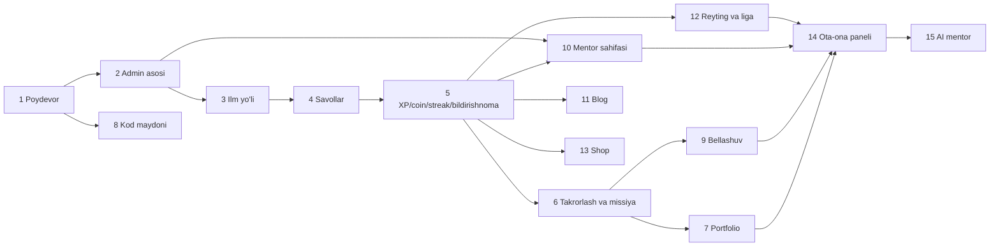

# 14. Yo'l xaritasi

> **Qisqa mazmun:** CLAUDE.md'dagi tartib bo'yicha 15 bosqichli ish rejasi. Har bir bosqich uchun baza, backend, frontend va test vazifalari, bog'liqliklar va tayyorlik mezoni (Definition of Done). Har bir bosqich ichida tartib: **avval baza → keyin backend → keyin frontend**.

---

## 0. Umumiy

### Bosqichlar bog'liqligi

- **8 (kod maydoni)** faqat poydevorga bog'liq, shuning uchun parallel olib borilishi mumkin.
- **10–13** bosqichlar 5-dan keyin bir-biridan mustaqil bo'lib, ketma-ketlikni o'zgartirish mumkin.
- **Taxmin:** Jamoa hajmi va muddatlar noma'lum, shuning uchun bosqichlarga vaqt baholari berilmadi. → S-65

### Har bir bosqich uchun umumiy DoD
- Prisma migratsiyasi va seed yangilangan.
- Barcha yangi endpointlar `@Roles` + scope bilan himoyalangan va rol × endpoint e2e testi bor.
- Unit testlar (servislar) va e2e testlar (asosiy oqimlar) CI'da o'tadi.
- OpenAPI hujjati va `packages/shared` tiplari yangilangan.
- UI mobil (360 px) va desktop'da tekshirilgan.
- `docs/` dagi tegishli hujjat va `99-ochiq-savollar.md` yangilangan.

---

## 1. Poydevor
**Bog'liq:** —
**Hujjatlar:** 01, 02, 13

| Qatlam | Vazifalar |
|---|---|
| Infra | Monorepo (pnpm + Turborepo), `apps/web`, `apps/api`, `packages/shared`, docker compose (Postgres, Redis, MinIO), ESLint/Prettier, CI (lint, typecheck, test), env konfiguratsiyasi |
| Baza | `users`, `refresh_tokens`, `parent_access_tokens`, `parent_access_logs`, `audit_logs`, `files`, `system_settings`; `student_code_seq`; seed: super admin (CLI) |
| Backend | Prisma moduli, Redis moduli, global exception filter va xatolik formati, logger (pino), `JwtAuthGuard`, `RolesGuard`, `ScopeGuard` karkasi, `ParentReadOnlyGuard`, `PasswordChangeRequiredGuard`, throttler; auth endpointlari (staff/student login, refresh rotation, logout, me, change-password, sessions, parent exchange); parent token CRUD; audit servisi; health check |
| Frontend | Next.js karkasi, dizayn tizimi asoslari (ranglar, tipografiya, tugmalar, inputlar), API client (access token xotirada, refresh), route guard'lar rol bo'yicha, login sahifalari (staff, student, parent), parolni majburiy almashtirish, bo'sh layout'lar (student/mentor/admin/parent) |
| Test | Auth unit testlari, rate limit, refresh reuse detection, `must_change_password` bloki, parent token revoke, parent `POST` → 403 |

**Tayyorlik mezoni:** 3 xil kirish ishlaydi. Har bir rol o'z bo'sh paneliga tushadi. Bekor qilingan parent token keyingi so'rovda rad etiladi. Super admin CLI orqali yaratiladi. CI yashil.

## 2. Admin asosi: foydalanuvchilar va guruhlar
**Bog'liq:** 1
**Hujjatlar:** 01, 03 §4

| Qatlam | Vazifalar |
|---|---|
| Baza | `groups`, `group_members` (faol a'zolik uchun partial unique), `learning_paths` (minimal, guruh uchun FK) |
| Backend | Super admin: adminlar CRUD. Admin: mentorlar/studentlar CRUD, deaktivatsiya (`token_version++`), parolni tiklash (admin + mentor scope), CSV import (S-21), guruhlar CRUD, mentor biriktirish, a'zolar qo'shish/chiqarish; mentor scope servisi + Redis kesh; mentor uchun `GET /mentor/groups`, `/mentor/groups/:id/students` (hozircha progress'siz) |
| Frontend | Admin: foydalanuvchilar jadvallari (qidiruv, filtr, pagination), yaratish formalari (vaqtinchalik parolni bir marta ko'rsatish), guruh sahifasi; mentor: guruhlar va studentlar ro'yxati, student profilida parol tiklash va ota-ona tokeni boshqaruvi |
| Test | Mentor boshqa guruh studentini ko'ra olmaydi (404). Admin admin yarata olmaydi. Student ikki faol guruhda bo'la olmaydi |

**Tayyorlik mezoni:** Admin student/mentor/guruh yaratadi va mentorni biriktiradi. Mentor faqat o'z studentlarini ko'radi, parolini tiklaydi va ota-ona tokeni beradi.

## 3. Ilm yo'li va darslar
**Bog'liq:** 2
**Hujjatlar:** 05 §1–3

| Qatlam | Vazifalar |
|---|---|
| Baza | `learning_paths`, `path_sections`, `topics`, `lessons`, `path_chests`, `skills`, `topic_skills`, `student_path_enrollments`, `topic_progress`, `lesson_progress` |
| Backend | Kontent CRUD + tartiblash + nashr qilish; student xaritasi (`GET /student/path`, kesh); dars start/complete; ochilish qoidalari (mavzu/dars ketma-ketligi); takrorlash bloki uchun hook (6-bosqichda ulanadi); `lesson.completed`, `topic.completed` domen hodisalari; sandiq holatlari (ochish 5-bosqichda) |
| Frontend | Admin: yo'l daraxti muharriri (drag-and-drop), Markdown dars muharriri + preview; student: **ilm yo'li xaritasi** (asosiy dizayn ishi: zanjir, sandiqlar, holatlar, animatsiya), dars o'qish sahifasi (Markdown, kod bloklari, video embed) |
| Test | Ketma-ketlik qoidalari, nashr qilinmagan kontent studentga ko'rinmaydi, progress hisoblash |

**Tayyorlik mezoni:** Admin yo'l yaratadi va nashr qiladi. Student xaritani ko'radi, darslarni ketma-ket o'qiydi, progress foizi to'g'ri ko'rsatiladi.

## 4. Savollar bazasi
**Bog'liq:** 3
**Hujjatlar:** 05 §6

| Qatlam | Vazifalar |
|---|---|
| Baza | `questions`, `question_options`, `question_attempts` |
| Backend | Savollar CRUD, arxivlash, import (CSV/JSON); `QuestionPicker` servisi; `POST /student/answers` (server tomonida tekshirish, `is_first_attempt`); dars savollari; mavzu yakunlash mezoni (S-31); statistika hisoblagichlari |
| Frontend | Admin: savollar banki (filtr, muharrir, har bir tur uchun forma, preview); student: dars ichidagi savol komponentlari (har bir tur), darhol feedback va izoh |
| Test | To'g'ri javob javob berilgunga qadar klientga chiqmaydi. Birinchi urinish unikal. Har bir tur uchun tekshiruv |

**Tayyorlik mezoni:** Darslar savollar bilan ishlaydi, mavzu mezon asosida yakunlanadi, admin savol statistikasini ko'radi.

## 5. XP, coin, streak, bildirishnomalar
**Bog'liq:** 4
**Hujjatlar:** 04, 03 §2.14

| Qatlam | Vazifalar |
|---|---|
| Baza | `student_stats`, `xp_transactions`, `coin_transactions`, `activity_days`, `reward_settings`, `setting_changes`, `achievements`, `student_achievements`, `notifications`, `chest_openings` |
| Backend | `SettingsService` (validatsiya, kesh, pub/sub); `RewardService` (ledger, idempotentlik, agregat); dars/savol/mavzu/sandiq mukofotlari; streak servisi + `streak.reset` va `streak.reminder` job'lari; yutuqlar dvigateli; admin tuzatishi; `NotificationService` + Socket.IO `/rt` (`notification:new`, `wallet:updated`, `streak:updated`); worker jarayoni va BullMQ; `ledger.reconcile` |
| Frontend | **Yuqori panel** (streak, XP, coin, bildirishnomalar, real-time); mukofot animatsiyalari; bildirishnomalar sahifasi va dropdown; profil — tranzaksiyalar tarixi; admin: sozlamalar sahifasi, yutuqlar CRUD, hamyon tuzatish |
| Test | Idempotentlik (bir xil hodisa 2 marta → 1 tranzaksiya), parallel so'rovlarda coin manfiy bo'lmaydi, streak chegaralari (Asia/Tashkent yarim tunida), sozlama o'zgarishi eski yozuvlarga ta'sir qilmaydi, rekonsilyatsiya |

**Tayyorlik mezoni:** Hech bir XP/coin qiymati kodda qattiq yozilmagan. Yuqori panel real-time yangilanadi. Ledger va agregat mos keladi.

## 6. Takrorlash va kunlik missiya
**Bog'liq:** 5
**Hujjatlar:** 05 §2.2, §4, §5; 04 §4

| Qatlam | Vazifalar |
|---|---|
| Baza | `review_schedules`, `review_sessions`, `review_logs`, `daily_missions`, `weekly_quizzes`, `weekly_quiz_attempts` |
| Backend | `ReviewScheduler` interfeysi + SM-2 implementatsiyasi; mavzu yakunlanganda birinchi rejalashtirish; takrorlash sessiyalari; yangi darsni bloklash qoidasi (S-30); kunlik missiyalar (generatsiya, progress, mukofot); haftalik quiz (yaratish job'i, urinish, vaqt limiti); `review.due-notify` |
| Frontend | Takrorlash sahifasi va sessiya UI; "Bugungi missiya" sahifasi; haftalik quiz UI (taymer); xaritada "Avval takrorlang" holati |
| Test | SM-2 hisoblari (jadvalli testlar), blok qoidasi va kunlik limit, quiz vaqt limiti serverda, missiya idempotentligi |

**Tayyorlik mezoni:** Mavzu tugagach takrorlash rejalashtiriladi, due bo'lganda yangi dars bloklanadi, kunlik missiya va haftalik quiz ishlaydi.

## 7. Portfolio
**Bog'liq:** 6 (va mentor baholashi uchun 2)
**Hujjatlar:** 09 §2

| Qatlam | Vazifalar |
|---|---|
| Baza | `portfolio_projects`, `project_images`, `project_skills`, `certificates`, `portfolio_share_links` |
| Backend | Statistika (o'zlashtirilgan mavzular, 1-urinish %, faol kunlar), o'sish grafigi, faollik kalendari, ko'nikmalar; loyihalar CRUD + topshirish; mentor baholashi (XP); sertifikatlar (avtomatik + qo'lda, PDF job, serial); public portfolio va verify; portfolio PDF eksport; fayl yuklash (pre-signed) |
| Frontend | Portfolio sahifasi (statistika kartochkalari, grafik, heatmap, ko'nikmalar, loyihalar, yutuqlar, sertifikatlar), ulashish sozlamasi, public sahifa (SSR + OG rasm); mentor: loyihalarni baholash navbati |
| Test | Public sahifada shaxsiy ma'lumot yo'q, o'chirilgan share link ishlamaydi, mentor faqat o'z guruhi loyihalarini baholaydi |

**Tayyorlik mezoni:** Portfolio barcha bloklari real ma'lumot bilan ishlaydi, ulashish va PDF yuklab olish ishlaydi.

## 8. Kod maydoni
**Bog'liq:** 1 (parallel olib borish mumkin)
**Hujjatlar:** 07

| Qatlam | Vazifalar |
|---|---|
| Baza | `code_snippets` |
| Backend | Snippetlar CRUD, limitlar |
| Frontend / infra | CodeMirror 6 editor; WEB: sandbox iframe `run.` subdomenida, console bridge, loop protection, Stop; PYTHON: Pyodide Web Worker, stdout/stderr terminal, `input()` (SharedArrayBuffer, COOP/COEP faqat `/playground`), terminate; darsdan "Kod maydonida ochish" |
| Test | Iframe asosiy domen cookie/storage'iga kira olmaydi, cheksiz sikl Stop bilan to'xtaydi, Python `input()` ishlaydi, mobil brauzerda sinov |

**Tayyorlik mezoni:** HTML/CSS/JS va Python kodlari xavfsiz ishga tushadi, natija/terminal ko'rinadi, snippetlar saqlanadi.

## 9. Bellashuv
**Bog'liq:** 6 (savollar, XP, o'tilgan mavzular)
**Hujjatlar:** 06

| Qatlam | Vazifalar |
|---|---|
| Baza | `battles`, `battle_questions`, `battle_answers`, `battle_invites` |
| Backend | `/battle` gateway; Redis adapter; matchmaking worker (Lua bilan atomar juftlash); taklif kodlari; savol tanlash (mavzular kesishmasi); server taymeri; bot simulyatsiyasi; reconnect/forfeit; natija + mukofot + kunlik limit |
| Frontend | Bellashuv bosh sahifasi (statistika, tarix), qidirish ekrani, taklif ulashish/qo'shilish, o'yin ekrani (taymer, raqib holati, natija animatsiyalari), reconnect UX |
| Test | Socket integratsiya testlari (2 klient), bitta studentning ikki marta juftlanmasligi, deadline'dan keyingi javob rad etiladi, uzilish → forfeit, yuklama testi (k6/Artillery) |

**Tayyorlik mezoni:** Tasodifiy, do'st bilan va bot rejimlari ishlaydi. Uzilishlar to'g'ri qayta ishlanadi. Natija va XP beriladi.

## 10. Mentor sahifasi: chat, meeting, materiallar
**Bog'liq:** 2, 5
**Hujjatlar:** 08

| Qatlam | Vazifalar |
|---|---|
| Baza | `conversations`, `messages`, `meetings`, `meeting_attendance`, `meeting_participant_events`, `materials`, `material_groups` |
| Backend | Chat (REST tarix + `/rt` eventlari, idempotentlik, o'qilganlik, presence); `MeetingProvider` + LiveKit (token, webhook, xona hayot sikli); meeting eslatmalari; davomat (avtomatik taklif + mentor tasdiqlashi + XP); materiallar (pre-signed yuklash); mentor dashboard va student tafsilotlari (progress, natijalar) |
| Frontend | Student "Mentor" sahifasi (chat, meetinglar, materiallar, profil); mentor: chat, meeting kalendari, meeting xonasi UI (LiveKit components), davomat jadvali, materiallar, dashboard |
| Test | Student boshqa mentorga yoza olmaydi, guruhdan tashqari student meeting token ololmaydi, webhook imzosi, chat dublikatsiyasi yo'q |

**Tayyorlik mezoni:** Chat real-time ishlaydi. Mentor meeting belgilaydi, studentlar qo'shiladi, davomat saqlanadi. Materiallar yuklanadi va yuklab olinadi.

## 11. Blog
**Bog'liq:** 5 (bildirishnomalar), 7 (fayl yuklash)
**Hujjatlar:** 09 §1

| Qatlam | Vazifalar |
|---|---|
| Baza | `blog_posts`, `blog_likes`, `blog_comments`, `blog_reports` |
| Backend | Postlar CRUD, lenta (cursor), like/komment, shikoyatlar, avtomatik yashirish, taqiqlangan so'zlar filtri, moderatsiya, blog ban, rasm ishlov berish |
| Frontend | Lenta (X uslubi, cheksiz scroll), post yaratish (rasm), post sahifasi + kommentlar, shikoyat qilish; admin moderatsiya navbati |
| Test | Like unikal, yashirilgan post lentada yo'q, ban qilingan foydalanuvchi yoza olmaydi, XSS |

**Tayyorlik mezoni:** Studentlar post yozadi, like va komment qiladi. Admin moderatsiya qiladi.

## 12. Reyting va ligalar
**Bog'liq:** 5
**Hujjatlar:** 04 §5

| Qatlam | Vazifalar |
|---|---|
| Baza | `league_tiers`, `league_cohorts`, `league_memberships`; seed: tierlar |
| Backend | Cohort'ga taqsimlash (birinchi XP'da), weekly_xp yangilash (RewardService hook), Redis ZSET, `league.close-week` job (ko'tarilish/tushish, mukofotlar, bildirishnomalar), tarix; admin tier sozlamalari |
| Frontend | Liga sahifasi (jadval, zonalar, taymer), hafta yakuni natija modali, admin: tierlar va joriy cohort'lar |
| Test | Hafta yakuni hisob-kitoblari (tie-break, 0 XP, chekka tierlar), job qayta ishga tushganda idempotentlik, Asia/Tashkent chegarasi |

**Tayyorlik mezoni:** Haftalik liga avtomatik yopiladi va yangisi ochiladi. Ko'tarilish/tushish to'g'ri ishlaydi.

## 13. Shop
**Bog'liq:** 5
**Hujjatlar:** 09 §3

| Qatlam | Vazifalar |
|---|---|
| Baza | `shop_products`, `shop_orders` |
| Backend | Mahsulotlar CRUD, buyurtma (tranzaksiya, `FOR UPDATE`, coin yechish, stock), bekor qilish va refund, status oqimi, bildirishnomalar, audit |
| Frontend | Shop vitrinasi, xarid tasdiqlash, buyurtmalarim; admin: mahsulotlar, buyurtmalar navbati |
| Test | Parallel xaridlarda manfiy balans/stock bo'lmaydi, `Idempotency-Key`, refund idempotent |

**Tayyorlik mezoni:** Student coin bilan mahsulot oladi, admin buyurtmani bajaradi, bekor qilinganda coin qaytadi.

## 14. Ota-ona paneli
**Bog'liq:** 7, 9, 10, 12 (ko'rsatiladigan barcha ma'lumotlar)
**Hujjatlar:** 10

| Qatlam | Vazifalar |
|---|---|
| Baza | (yangi jadval yo'q) indekslarni tekshirish |
| Backend | `/parent/*` controller'lari, Parent DTO whitelist, ko'p farzandli session (merge), har bir so'rovda token faolligi, kesh, rate limit |
| Frontend | Mobil-first ota-ona paneli: farzand tanlagich, Umumiy / Progress / Natijalar / Davomat / Portfolio; farzand qo'shish; token bekor qilingan holat |
| Test | Barcha `/parent` endpointlari faqat GET, boshqa student ID → 404, bitta token bekor qilinsa boshqa farzandga kirish saqlanadi, javoblarda chat va to'g'ri javoblar yo'q |

**Tayyorlik mezoni:** Ota-ona token(lar) bilan kiradi va farzand(lar)ining tavsifdagi barcha ma'lumotlarini faqat o'qish rejimida ko'radi.

## 15. AI mentor (keyinroq)
**Bog'liq:** 14 va barcha ma'lumot manbalari
**Holat:** Hozircha qilinmaydi. Faqat arxitekturada joy qoldirilgan (13 §10).
Boshlashdan oldin aniqlanishi kerak: vazifasi (dars bo'yicha savol-javob, kodni tushuntirish, shaxsiy reja), LLM provayderi, xarajat limiti, xavfsizlik (bolalar), mentorning nazorati. → S-66

---

## Ochiq savollar (shu modul)

- **S-65** Jamoa hajmi, muddatlar va birinchi relizga (MVP) qaysi bosqichlar kiradi?
- **S-66** AI mentor nima qilishi kerak va qachon boshlanadi?
